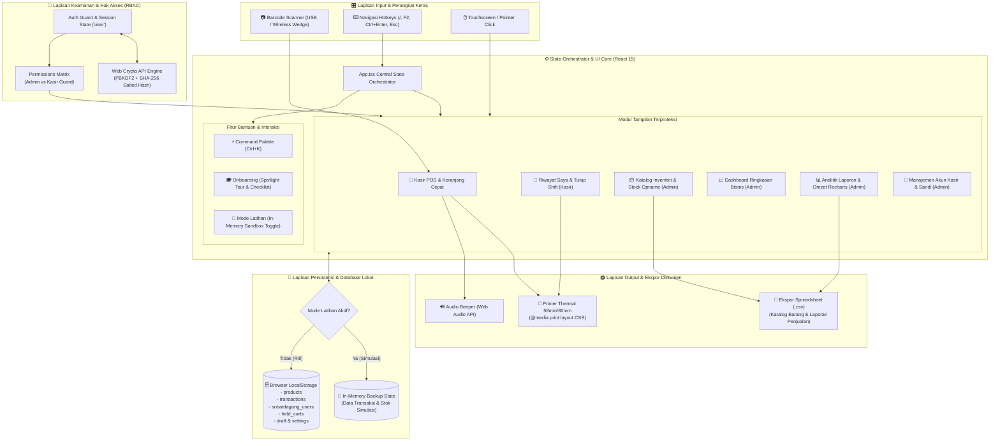

# 🛒 SobatDagang POS & Inventory

<div align="center">


### Sistem Kasir Digital (POS) & Manajemen Inventori UMKM Modern

[](https://react.dev/)
[](https://www.typescriptlang.org/)
[](https://vitejs.dev/)
[](https://tailwindcss.com/)
[](https://motion.dev/)
[](https://developer.mozilla.org/en-US/docs/Web/API/Window/localStorage)
[](LICENSE)

*Aplikasi web Point of Sale (POS) dan manajemen inventori toko ritel/kelontong yang cepat, zero-latency, dan 100% siap pakai tanpa setup server database rumit. Dilengkapi kontrol hak akses (RBAC), enkripsi sandi Web Crypto API, analitik keuangan, cetak struk thermal riil, serta mode simulasi/latihan (Sandbox) untuk kasir baru.*

<br />

### 🖥️ Preview Antarmuka Sistem POS Kasir SobatDagang


</div>

---

## 📌 Ringkasan Sistem (Executive Overview)

**SobatDagang** dirancang untuk memecahkan friksi terbesar operasional UMKM ritel dan toko kelontong di Indonesia:
1. **Ketergantungan Server yang Lambat**: Kasir terhambat antrean jika koneksi internet terputus atau server database lambat merespons.
2. **Kerahasiaan Omzet & Margin Modal**: Kasir tidak boleh melihat total keuntungan dan omzet pemilik toko, namun tetap harus bisa merekap saldo uang fisik laci kasir saat pergantian shift.
3. **Ketakutan Staf Baru Terhadap Kesalahan Data**: Kasir baru sering takut salah klik nota atau merusak stok saat proses training.
4. **Setup Perangkat Keras yang Rumit**: Kebutuhan integrasi scanner dan printer thermal yang sering kali membutuhkan instalasi driver rumit.

> [!NOTE]
> **Arsitektur Realita**: SobatDagang adalah **Client-First / Offline-Ready SPA** yang berjalan sepenuhnya di sisi browser klien. Seluruh data transaksi, katalog barang, dan kredensial pengguna tersimpan aman di `localStorage` peramban. Sistem ini dapat dideploy secara statis (Vercel, Netlify, Cloudflare Pages, GitHub Pages) dan langsung beroperasi seketika dengan latensi 0ms.

---

## 📐 Arsitektur Sistem Riil (Real System Architecture)

### 1. Diagram Alur Data & Komponen End-to-End

<div align="center">
  
</div>

<br />



---

### 2. Penjelasan Tiap Lapisan (Layer Breakdown)

| Lapisan | Komponen Utama | Implementasi Nyata di Kode |
| :--- | :--- | :--- |
| **Presentation & UI** | React 19, Tailwind CSS v4, Motion v12 | Menghadirkan desain editorial modern berestetika hangat (*warm merchant style*). Mendukung transisi halus, popover dinamis, dan dialog modal yang teruji aksesibilitasnya (`prefers-reduced-motion` aware). |
| **State Orchestration** | React Hooks, `useLocalStorage`, `useUndoToast` | Seluruh siklus transaksi kasir, kalkulasi subtotal, diskon, pajak, perhitungan kembalian uang pas, dan sinkronisasi stok diorkestrasi di `src/App.tsx`. |
| **Security & RBAC** | `src/lib/crypto.ts`, `src/lib/permissions.ts` | Menggunakan standar enkripsi browser bawaan **Web Crypto API** (`crypto.subtle`) untuk hashing kata sandi dengan PBKDF2 (100.000 iterasi dan salt acak). Pembatasan akses view dilakukan di level komponen dengan `RoleGuard`. |
| **Persistensi Data** | HTML5 `localStorage` API | Data operasional toko tersimpan terstruktur dalam format JSON di storage browser. Menyediakan kapasitas hingga ribuan transaksi dan SKU tanpa perlu konfigurasi database eksternal. |
| **Mode Latihan (Sandbox)** | `src/features/onboarding/` | Fitur isolasi data di mana sistem membuat snapshot cadangan (*in-memory backup*) dari data asli. Saat kasir baru berlatih checkout dan potong stok, data asli toko tetap aman dan dapat dipulihkan seketika. |
| **Integrasi Perangkat** | Web API, CSS `@media print`, Keyboard Wedge | Kompatibel *plug-and-play* dengan barcode scanner USB/Wireless standar (keyboard emulation) dan printer struk thermal ukuran 58mm serta 80mm via dialog cetak browser native. |

---

## 🗄️ Skema Data & Penyimpanan Lokal (Data Persistence Model)

SobatDagang menggunakan kunci penyimpanan lokal (`localStorage`) yang terstandarisasi untuk menjamin integritas data:

```text
localStorage
├── "user"                           -> Sesi login aktif (User)
├── "sobatdagang_users"              -> Database akun & hash password (AppUser[])
├── "products"                       -> Katalog produk & inventori (Product[])
├── "transactions"                   -> Riwayat seluruh nota penjualan (Transaction[])
├── "held_carts"                     -> Daftar transaksi antrean yang ditahan (HeldCart[])
├── "sobatdagang_product_draft"      -> Draf formulir barang baru yang belum tersimpan
├── "sobatdagang_remember_username"  -> Preferensi username tersimpan pada form login
└── "sobatdagang_onboarding_{uid}"   -> State kemajuan checklist onboarding pengguna
```

### Definisi Entitas Kunci (TypeScript Interfaces)

<details>
<summary><b>Klik untuk melihat struktur entitas data utama</b></summary>

```typescript
// Master Data Produk
export interface Product {
  id: string;
  code: string;        // SKU / Barcode (contoh: 'BRG001')
  name: string;        // Nama barang
  category: string;    // Kategori (Beras, Minyak, Minuman, dsb.)
  buyPrice: number;    // Harga pokok / modal beli
  sellPrice: number;   // Harga jual kasir
  stock: number;       // Jumlah fisik stok tersisa
  minStock: number;    // Ambang batas peringatan stok tipis
  unit: string;        // Satuan barang (pcs, botol, kg, pack)
  image?: string;      // URL gambar atau base64 data preview
}

// Rekaman Transaksi Penjualan
export interface Transaction {
  id: string;                  // Nomor Invoice unik (contoh: 'INV-20261015-001')
  date: string;                // ISO timestamp transaksi
  items: CartItem[];           // Daftar barang belanjaan beserta kuantitas & diskon
  total: number;               // Total nominal belanja (Rp)
  received: number;            // Uang tunai yang diserahkan pelanggan
  change: number;              // Nominal kembalian
  paymentMethod: PaymentMethod;// 'CASH' atau 'QRIS'
  userId: string;              // ID kasir yang melayani
  userName: string;            // Nama kasir yang tercetak di struk
}

// Data Pengguna & Kredensial RBAC
export interface AppUser {
  id: string;
  name: string;
  username: string;
  role: 'ADMIN' | 'KASIR';
  isActive: boolean;
  passwordHash: string;        // Hash PBKDF2 SHA-256 (bukan plain text)
  mustChangePassword?: boolean;// Paksa ganti password saat reset oleh admin
  lastLogin?: string;
  createdAt: string;
}
```

</details>

---

## 👥 Matriks Hak Akses Peran (Role-Based Access Control)

<div align="center">
  
</div>

<br />

SobatDagang membagi wewenang pengguna secara ketat antara **Administrator** (pemilik toko/supervisor) dan **Kasir** (staf meja kasir):

| Fitur / Halaman | Admin | Kasir | Penjelasan Kebijakan Bisnis |
| :--- | :---: | :---: | :--- |
| **Dashboard Bisnis** | ✅ | ❌ | Menyajikan grafik omzet total, laba bersih, dan tren harian toko. Dilarang bagi kasir demi privasi bisnis. |
| **POS Kasir** | ✅ | ✅ | Transaksi penjualan langsung, scan barcode, penahanan nota (*Hold Cart*), dan cetak struk kasir. |
| **Riwayat Saya (Shift Kasir)** | ✅ | ✅ | Kasir hanya dapat melihat riwayat transaksi miliknya sendiri hari ini dan rekap uang fisik laci tanpa melihat keuntungan toko. |
| **Inventori & SKU** | ✅ | ❌ | Tambah barang, ubah harga beli/jual, sesuaikan stok, dan ekspor CSV katalog. |
| **Laporan Penjualan** | ✅ | ❌ | Analitik keuangan lengkap, margin kotor/bersih, performa kasir, dan ekspor CSV transaksi. |
| **Kelola Pengguna** | ✅ | ❌ | Tambah staf kasir, nonaktifkan akun, ganti peran, dan reset sandi dengan pengamanan *force reset*. |
| **Mode Latihan (Sandbox)** | ✅ | ✅ | Simulasi transaksi bebas risiko bagi kasir baru tanpa merusak data pembukuan asli toko. |

> [!IMPORTANT]
> **Aturan Keamanan Sistem Pengguna**:
> 1. Akun Admin tidak dapat menurunkan (*demote*) role atau menghapus akunnya sendiri saat sedang login.
> 2. Sistem mencegah penghapusan akun Admin terakhir; minimal harus selalu ada satu Administrator aktif.
> 3. Kata sandi yang di-reset oleh Admin akan menandai flag `mustChangePassword = true`, mewajibkan staf mengganti password pribadi saat login pertama.

---

## 🔄 Alur Operasional Nyata di Lapangan (Real-World Workflows)

### 1. Transaksi Penjualan Meja Kasir Cepat

<div align="center">
  
</div>

<br />

```text
[Pembeli Tiba di Kasir]
        │
        ▼
[Tekan '/' atau Scan Barcode] ──> [Barang Masuk ke Keranjang Otomatis]
        │
        ├── Pelanggan lupa ambil barang? ──> [Tekan F2: Simpan Keranjang / Hold Cart]
        │                                    [Layani Pelanggan Lain di Antrean]
        │                                    [Tekan F2 Kembali: Pulihkan Keranjang]
        ▼
[Tekan Ctrl+Enter atau Tombol Bayar]
        │
        ├── Metode TUNAI: Pilih tombol "Uang Pas" atau pecahan cepat (Rp 20.000, Rp 50.000, Rp 100.000)
        └── Metode QRIS : Tampilkan QR code dinamis toko ──> Konfirmasi status bayar
        │
        ▼
[Sistem Menampilkan Animasi Kembalian (CountUp)]
        │
        ▼
[Stok Barang Terpotong Otomatis di LocalStorage]
        │
        ▼
[Cetak Struk Thermal via Browser Print (Ctrl+P)] ──> [Selesai / Buka Transaksi Baru]
```

### 2. Prosedur Serah Terima Shift & Tutup Kasir (End of Shift)
```text
[Kasir Masuk ke Menu "Riwayat Saya"]
        │
        ▼
[Klik Tombol "Ringkasan Tutup Kasir"]
        │
        ▼
[Sistem Menampilkan: Total Uang Tunai di Laci & Total QRIS Khusus Shift Tersebut]
        │
        ▼
[Kasir Menghitung Fisik Uang di Laci] ──> [Cocokkan dengan Angka Ringkasan]
        │
        ▼
[Cetak Laporan Tutup Shift Thermal] ──> [Serahkan Fisik Kas & Struk ke Supervisor]
```

### 3. Simulasi Kasir Baru dengan Mode Latihan (Practice Mode)
```text
[Kasir Baru Mengaktifkan "Mode Latihan" di Bantuan / Banner]
        │
        ▼
[Sistem Membuat Snapshot Memori: Backup State Produk & Transaksi Asli]
        │
        ▼
[Banner Oranye Aktif: "Mode Latihan Aktif - Data Tidak Disimpan Permanen"]
        │
        ▼
[Kasir Bebas Berlatih: Input Belanja, Simulasi QRIS, Pembayaran Tunai, Hold Cart]
        │
        ▼
[Klik "Keluar Mode Latihan"] ──> [Sistem Memulihkan Data Asli Toko 100% Bersih]
```

---

## 🖨️ Integrasi Perangkat Keras Kasir (Hardware Setup)

SobatDagang dibuat agar dapat langsung bekerja dengan perangkat kasir standar tanpa instalasi software perantara yang rumit:

### 1. Barcode Scanner (USB / Wireless 2.4 GHz)
- **Tipe**: Standar *Keyboard Wedge / HID Emulation*.
- **Cara Kerja**: Scanner membaca kode batang (EAN-13, UPC, Code 128) dan mengetikkannya sebagai input keyboard yang diakhiri karakter `Enter`.
- **Implementasi**: Tekan tombol <kbd>/</kbd> untuk memfokuskan kursor ke kolom pencarian POS. Saat barcode ditembak, produk yang SKU-nya cocok langsung otomatis masuk ke keranjang belanja dengan efek suara *beep*.

### 2. Printer Struk Kasir Thermal (58mm & 80mm)
- **Tipe**: Printer thermal USB, Bluetooth, atau LAN (misalnya tipe Epson TM-T82, Panda, POS-58, Iware, Kassen).
- **Cara Kerja**: Menggunakan native browser print API (`window.print()`).
- **Desain Khusus Struk**:
  - CSS `@media print` secara otomatis menyembunyikan navigasi, sidebar, dan tombol antarmuka web.
  - Elemen `#receipt` diisolasi dengan batas lebar standar **380px** (pas untuk kertas thermal 58mm dan 80mm).
  - Teks diformat dalam font monospaced berkontras tinggi dengan rincian nama toko, nomor invoice, daftar item, total, uang diterima, kembalian, dan ucapan terima kasih.

---

## ⌨️ Daftar Lengkap Pintasan Keyboard (Hotkeys)

Tingkatkan kecepatan kasir dan navigasi tanpa perlu menyentuh mouse:

| Pintasan Keyboard | Halaman / Lingkup | Fungsi Operasional |
| :--- | :--- | :--- |
| <kbd>/</kbd> | POS Kasir & Inventori | Fokus langsung ke kolom pencarian produk / barcode scanner |
| <kbd>Ctrl</kbd> + <kbd>K</kbd> / <kbd>⌘</kbd> + <kbd>K</kbd> | Global (Seluruh Halaman) | Buka **Command Palette** untuk berpindah menu dengan cepat |
| <kbd>Shift</kbd> + <kbd>/</kbd> (<kbd>?</kbd>) | Global (Seluruh Halaman) | Buka **Pusat Bantuan, Panduan Tutorial, & FAQ** |
| <kbd>Ctrl</kbd> + <kbd>Enter</kbd> | POS Kasir | Buka modal konfirmasi pembayaran seketika |
| <kbd>F2</kbd> | POS Kasir | Tahan antrean transaksi (*Hold Cart*) / Pulihkan keranjang belanja |
| <kbd>N</kbd> | Inventori Produk | Buka formulir tambah produk baru (khusus Admin) |
| <kbd>Esc</kbd> | Global Modal / Drawer | Tutup dialog pop-up, modal pembayaran, atau drawer samping |

---

## 🛠️ Spesifikasi Teknologi (Tech Stack)

- **Frontend Framework**: [React 19](https://react.dev/) + [TypeScript 5.8](https://www.typescriptlang.org/)
- **Build Tool**: [Vite 6](https://vitejs.dev/) (Fast HMR & optimal rollup production chunking)
- **CSS Framework**: [Tailwind CSS v4](https://tailwindcss.com/) dengan arsitektur tema kustom
- **Animasi & Interaksi**: [Motion (Framer Motion v12)](https://motion.dev/)
- **Visualisasi Data & Grafik**: [Recharts v3](https://recharts.org/) (Grafik Omzet Harian & Pie Chart Metode Pembayaran)
- **Ikonografi**: [Lucide React](https://lucide.dev/)
- **Keamanan Kriptografi**: Native Browser [Web Crypto API](https://developer.mozilla.org/en-US/docs/Web/API/Web_Crypto_API) (`PBKDF2`, `SHA-256`, 100.000 iterasi)
- **Format Tanggal & Angka**: `Intl.NumberFormat` (Rupiah Indonesia) & `Intl.DateTimeFormat`

---

## 🚀 Panduan Memulai & Instalasi (Quick Start)

### Prasyarat
- [Node.js](https://nodejs.org/) versi 18.0 atau lebih tinggi
- Paket manajer: `npm`, `pnpm`, atau `yarn`

### Langkah Pemasangan

1. **Clone Repositori**:
   ```bash
   git clone https://github.com/agungrmdniiii/Sobat-Dagang.git
   cd Sobat-Dagang
   ```

2. **Pasang Dependensi**:
   ```bash
   npm install
   ```

3. **Jalankan Server Pengembangan**:
   ```bash
   npm run dev
   ```
   Aplikasi langsung aktif di peramban pada alamat `http://localhost:3000`.

4. **Kompilasi Siap Produksi (Build)**:
   ```bash
   npm run build
   ```
   Hasil kompilasi statis akan berada di direktori `dist/` dan siap dideploy ke layanan hosting statis apa pun.

---

## 🔑 Kredensial Akun Demo Bawaan

Sistem sudah dilengkapi dengan 2 akun awal untuk kebutuhan uji coba:

| Username | Password | Role | Hak Akses Utama |
| :--- | :--- | :--- | :--- |
| `admin` | `admin123` | **ADMIN** | Hak Akses Penuh: Dashboard, POS, Inventori, Laporan Omzet, Kelola Pengguna |
| `kasir` | `kasir123` | **KASIR** | Meja Kasir POS, Tahan Transaksi (Hold Cart), Riwayat Shift Saya, Tutup Kasir |

> [!TIP]
> **Skenario Evaluasi yang Direkomendasikan**:
> 1. Masuk sebagai `kasir`: Lakukan transaksi penjualan, coba tahan antrean belanja dengan <kbd>F2</kbd>, proses pembayaran dengan *Quick Cash*, lalu cetak struk thermal.
> 2. Buka menu **Riwayat Saya**: Klik **Ringkasan Tutup Kasir** untuk melihat rekonsiliasi kas shift.
> 3. Logout dan masuk sebagai `admin`: Pantau kenaikan omzet di grafik **Dashboard** dan **Laporan**, ubah stok di **Inventori**, atau tambahkan kasir baru di menu **Pengguna**.

---

## 📂 Struktur Direktori Proyek

```text
Sobat-Dagang/
├── index.html                   # HTML entry point dengan link font DM Sans
├── package.json                 # Konfigurasi dependensi & npm scripts
├── vite.config.ts               # Konfigurasi bundler Vite 6 & Tailwind CSS v4
├── tsconfig.json                # Konfigurasi compiler TypeScript
├── src/
│   ├── main.tsx                 # Bootstrapper React 19
│   ├── App.tsx                  # State orchestrator sentral, POS view, cart, & modal transaksi
│   ├── index.css                # Tailwind base, CSS variables tema warm editorial, & @media print
│   ├── types.ts                 # Definisi TypeScript interface (Product, Transaction, AppUser, dsb.)
│   ├── constants.ts             # Data inisial katalog sembako, kategori produk, & pengguna awal
│   │
│   ├── components/
│   │   ├── auth/                # Halaman login, validasi sesi, & form force-reset password
│   │   ├── dashboard/           # Tampilan ringkasan metrik KPI, grafik omzet, & notifikasi stok
│   │   ├── global/              # Sidebar navigasi, Topbar, Command Palette (Ctrl+K), Settings Panel
│   │   ├── inventory/           # Tampilan inventori, pencarian SKU, filter stok, edit cepat, ekspor CSV
│   │   ├── motion/              # Komponen animasi reusable (CountUp, FadeIn, StaggerList, PageTransition)
│   │   ├── pos/                 # Komponen pendukung kasir & tampilan "Riwayat Saya" (MyHistoryView)
│   │   ├── reports/             # Laporan penjualan mendalam, analitik Recharts, filter tanggal, ekspor CSV
│   │   ├── ui/                  # Komponen antarmuka atomik (Button, Card, Modal, Drawer, Table, Toast, Badge)
│   │   └── users/               # Pengelolaan akun pengguna, penetapan peran RBAC, dan reset sandi
│   │
│   ├── features/
│   │   └── onboarding/          # Engine tutorial: GuidedTour (spotlight SVG), Checklist, HelpDrawer, Sandbox
│   │
│   ├── hooks/                   # Custom React hooks (useHotkeys, useLocalStorage, useUndoToast, useDebounce)
│   └── lib/                     # Helper utilitas, enkripsi Web Crypto API (crypto.ts), dan aturan RBAC
└── public/                      # Aset statis & ikon
```

---

## 🌐 Panduan Deployment

Karena SobatDagang adalah Single Page Application murni tanpa dependensi server runtime, Anda dapat mendeploynya ke berbagai penyedia hosting statis secara gratis:

- **Vercel**: Hubungkan repositori GitHub Anda dan pilih framework preset *Vite*.
- **Netlify**: Set build command `npm run build` dan publish directory `dist`.
- **Cloudflare Pages**: Pilih framework *Vite*, build command `npm run build`, output folder `dist`.
- **GitHub Pages**: Gunakan GitHub Actions untuk mem-build dan mem-publish folder `dist` secara otomatis.

---

## 📄 Lisensi

Proyek ini didistribusikan di bawah lisensi **MIT**. Bebas digunakan, dipelajari, dimodifikasi, dan diterapkan untuk mendukung digitalisasi UMKM dan toko kelontong di seluruh Indonesia.

<div align="center">
  Dibuat dengan ❤️ untuk kemajuan UMKM, Toko Kelontong, dan Ritel Modern Indonesia
</div>
