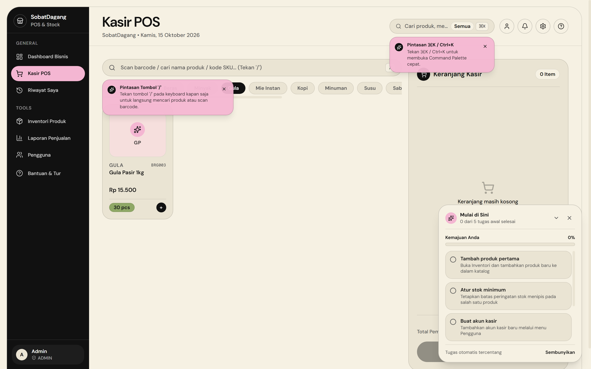
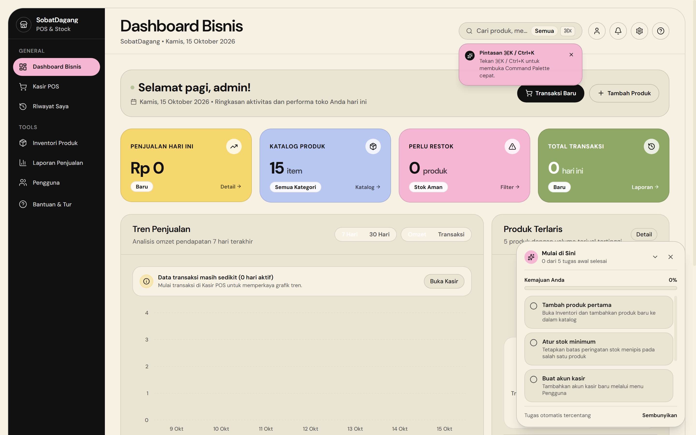
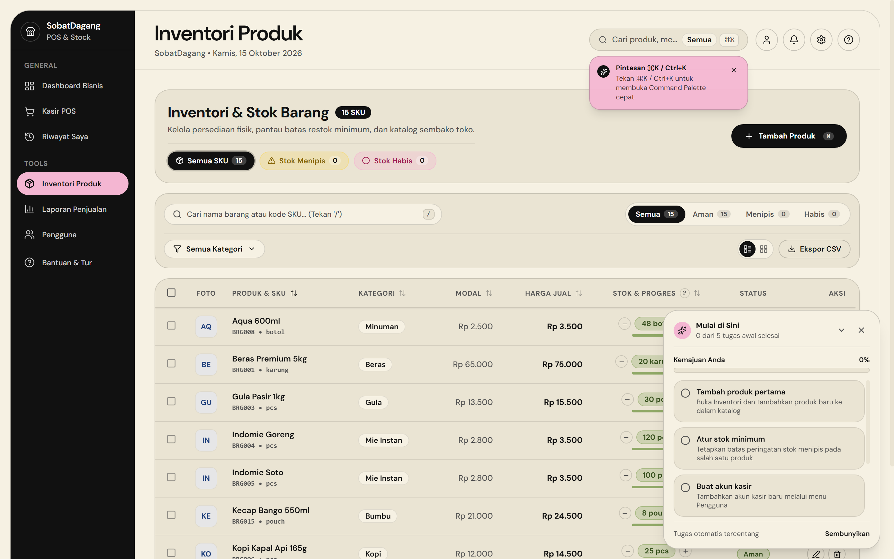
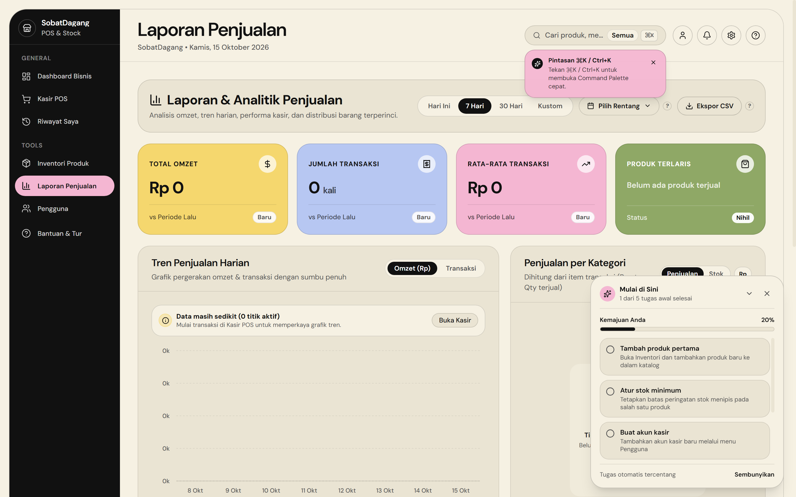
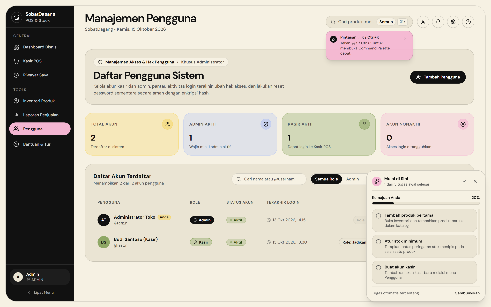
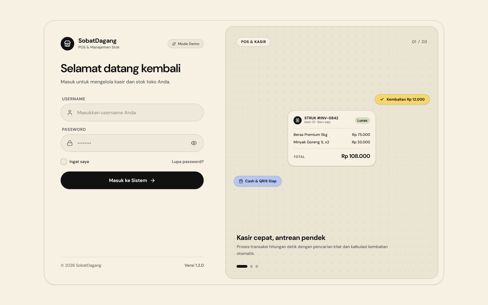
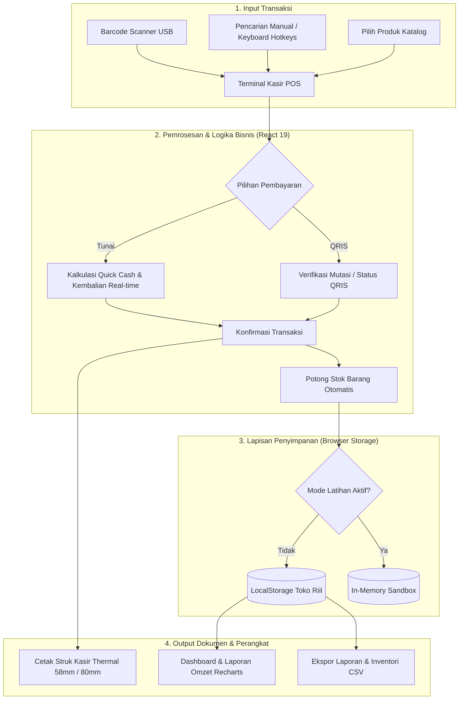

# 🛒 SobatDagang — Sistem Kasir (POS) & Inventori UMKM

Sistem kasir digital *(Point of Sale)* dan manajemen stok barang modern berbasis web yang cepat, responsif, dan **100% siap pakai langsung di browser** tanpa ketergantungan server database eksternal.

[](https://sobat-dagang.vercel.app/)
[](https://github.com/agungrmdniiii/Sobat-Dagang)

---

## 🌐 Live Preview & Akun Demo

Aplikasi sudah aktif dan dapat diakses langsung secara interaktif di browser:

👉 **[https://sobat-dagang.vercel.app/](https://sobat-dagang.vercel.app/)**

### Kredensial Login Bawaan

| Peran (Role) | Username | Password | Cakupan Hak Akses |
| :--- | :--- | :--- | :--- |
| **Administrator** | `admin` | `admin123` | Akses penuh: Dashboard Bisnis, Inventori Produk, Laporan Omzet & Laba, Kelola Pengguna, dan POS Kasir |
| **Kasir** | `kasir` | `kasir123` | Fokus meja kasir: Transaksi POS, Tahan Keranjang (<kbd>F2</kbd>), Riwayat Shift Saya, dan Rekap Tutup Kasir |

> *Catatan: Data yang Anda input saat mencoba demo tersimpan secara lokal dan terisolasi di browser masing-masing (`localStorage`), sehingga aman dan tidak akan bercampur dengan pengunjung lain.*

---

## 📸 Tangkapan Layar Sistem Asli (Real Screenshots)

Berikut adalah tangkapan layar asli yang diambil langsung dari sistem produksi [sobat-dagang.vercel.app](https://sobat-dagang.vercel.app/):

### 1. 🛒 Terminal Kasir (POS) & Transaksi Cepat
*Meja kasir dengan pencarian barcode instan, pemilihan kategori produk, keranjang belanja, kalkulasi uang pas (Quick Cash), dan cetak struk thermal.*


<br />

### 2. 📊 Dashboard Analitik Bisnis (Khusus Admin)
*Ringkasan performa penjualan harian, total produk katalog, notifikasi barang perlu restok, dan grafik tren omzet pendapatan.*


<br />

### 3. 📦 Manajemen Inventori & Peringatan Stok
*Katalog master data SKU, status stok otomatis (Aman, Menipis, Habis), penyesuaian stok langsung (+/-), dan ekspor data CSV.*


<br />

### 4. 📈 Laporan Penjualan & Keuangan
*Analitik keuangan mendalam, tren omzet harian, grafik distribusi penjualan per kategori, dan rekapitulasi data siap ekspor.*


<br />

### 5. 👥 Manajemen Pengguna & Hak Akses (RBAC)
*Pengelolaan akun kasir dan admin, pemantauan status aktif, dan reset password aman dengan enkripsi Web Crypto API.*


<br />

### 6. 🔐 Halaman Login & Pemilih Akun Demo
*Antarmuka autentikasi dengan tombol cepat Mode Demo untuk menguji peran Admin maupun Kasir dalam satu klik.*


---

## 📌 Gambaran Sistem Nyata (Real System Overview)

SobatDagang dibangun dengan arsitektur **Client-First / Offline-First Single Page Application (SPA)** menggunakan React 19, TypeScript, Vite, Tailwind CSS v4, dan Motion.

### Mengapa sistem ini dibangun client-first?
1. **Zero Latency di Meja Kasir**: Kasir tidak perlu menunggu response request database cloud setiap kali menembak barcode. Scan barang, hitung kembalian, dan cetak nota berjalan seketika (0 milidetik).
2. **Kemandirian Jaringan**: Tetap dapat memproses transaksi meskipun koneksi internet toko sedang lambat atau terputus.
3. **Kerahasiaan Finansial Toko**: Memisahkan peran kasir dan admin secara ketat. Kasir tidak bisa melihat total omzet bulanan, margin modal, maupun laba bersih pemilik toko.
4. **Zero Server Maintenance**: Tidak memerlukan sewa server VPS, instalasi database MySQL/PostgreSQL, ataupun setup API backend yang rumit. Cukup buka browser atau deploy secara statis.

---

## 📐 Arsitektur & Alur Kerja Sistem

Seluruh logika bisnis, kalkulasi harga, pemotongan stok, enkripsi sandi, dan penyimpanan transaksi dikelola langsung di sisi peramban klien:



---

## 👥 Matriks Hak Akses Pengguna (RBAC)

SobatDagang menerapkan pembatasan hak akses berbasis peran (*Role-Based Access Control*) yang ketat:

| Halaman / Fitur | Administrator | Kasir | Penjelasan Kebijakan |
| :--- | :---: | :---: | :--- |
| **Dashboard Bisnis** | ✅ | ❌ | Ringkasan metrik omzet, total transaksi harian, dan peringatan stok menipis. |
| **POS Kasir** | ✅ | ✅ | Meja transaksi cepat, scan barcode, simpan antrean (*Hold Cart*), dan cetak nota. |
| **Riwayat Saya (Shift Kasir)** | ✅ | ✅ | Kasir hanya dapat melihat riwayat transaksi miliknya sendiri pada shift hari ini dan rekap uang laci kas. |
| **Inventori & Stok** | ✅ | ❌ | Master data SKU, penyesuaian stok fisik (+/-), harga beli modal, harga jual, dan ekspor CSV inventori. |
| **Laporan Penjualan** | ✅ | ❌ | Analitik keuangan lengkap, grafik omzet harian, grafik metode bayar, estimasi laba bersih, dan ekspor laporan CSV. |
| **Kelola Pengguna** | ✅ | ❌ | Menambah staf kasir baru, reset sandi staf, dan menonaktifkan akun. |
| **Mode Latihan (Sandbox)** | ✅ | ✅ | Ruang uji coba bagi kasir baru tanpa risiko merusak data pembukuan asli toko. |

### Kebijakan Keamanan Akun
- **Enkripsi Sandi**: Kata sandi di-hash menggunakan **Web Crypto API** native browser (`crypto.subtle`) dengan algoritma **PBKDF2** (SHA-256, 100.000 iterasi, serta *salt* unik per pengguna).
- **Proteksi Admin Tunggal**: Sistem secara otomatis mencegah penurunan role atau penghapusan akun Administrator jika hanya tersisa satu akun Admin aktif.
- **Wajib Ganti Sandi**: Saat Admin mereset kata sandi seorang kasir, sistem menandai akun tersebut agar wajib membuat kata sandi baru pada login berikutnya.

---

## ⚡ Fitur-Fitur Utama

### 1. Terminal Kasir POS Cepat
- **Scan Barcode Seketika (<kbd>/</kbd>)**: Fokus otomatis ke kolom pencarian produk. Kompatibel dengan semua jenis Barcode Scanner USB/Wireless (Keyboard Wedge).
- **Tahan Antrean / Hold Cart (<kbd>F2</kbd>)**: Saat pembeli ingin mengambil barang tambahan, kasir dapat menyimpan antrean sementara dan melayani pelanggan berikutnya tanpa membatalkan transaksi.
- **Pilihan Uang Cepat (Quick Cash)**: Tombol cerdas pecahan uang pas, Rp 10.000, Rp 20.000, Rp 50.000, dan Rp 100.000 yang mempercepat kalkulasi kembalian.
- **Kalkulasi Kembalian Dinamis**: Tampilan nominal kembalian dengan animasi angka yang jelas untuk mencegah salah hitung.
- **Cetak Struk Thermal**: Format struk teroptimasi untuk kertas kasir 58mm dan 80mm via dialog cetak browser (`Ctrl+P`).
- **Undo Transaksi**: Notifikasi toast dengan tombol batalkan (*undo*) 5 detik saat barang tidak sengaja terhapus dari keranjang.

### 2. Rekonsiliasi Tutup Shift (Menu Khusus Kasir)
- Kasir membuka tab **Riwayat Saya** di akhir jam kerja.
- Sistem menampilkan total transaksi, total kas tunai di laci, dan total transaksi QRIS khusus untuk shift kasir yang sedang bertugas.
- Menjaga kerahasiaan toko karena kasir tidak dapat melihat akumulasi omzet total atau keuntungan modal toko.

### 3. Manajemen Inventori & Peringatan Stok
- Pengelompokan status stok otomatis: **Aman**, **Hampir Habis** *(Low Stock)*, dan **Habis** *(Out of Stock)*.
- Tombol penyesuaian stok cepat (+/-) langsung di tabel tanpa harus membuka formulir edit.
- Penyimpanan draf formulir produk otomatis (*auto-draft*) agar data tidak hilang saat halaman browser tidak sengaja tertutup.
- Ekspor seluruh katalog barang ke file spreadsheet `.csv`.

### 4. Laporan Penjualan & Analitik Keuangan (Khusus Admin)
- Metrik finansial utama: **Total Omzet**, **Total Transaksi**, **Estimasi Laba Bersih**, dan **Rata-Rata Keranjang (AOV)**.
- Grafik visual interaktif: Tren omzet harian dan proporsi metode bayar (Tunai vs QRIS) menggunakan pustaka Recharts.
- Filter tanggal fleksibel: Hari ini, 7 hari terakhir, 30 hari terakhir, atau rentang tanggal kustom.
- Ekspor rincian transaksi lengkap ke file `.csv` untuk pembukuan akuntansi.

### 5. Mode Latihan Kasir (Interactive Sandbox)
- Fitur khusus untuk melatih karyawan kasir baru.
- Saat diaktifkan, sistem mencadangkan data asli toko ke memori sementara.
- Kasir baru bebas melakukan transaksi belanja, scan barcode, dan manipulasi stok.
- Saat keluar dari mode latihan, data asli toko dipulihkan kembali secara utuh tanpa ada nota fiktif yang masuk ke pembukuan.

---

## 🖨️ Integrasi Perangkat Keras

SobatDagang dirancang kompatibel langsung dengan perangkat keras kasir standar:

1. **Barcode Scanner (USB / Wireless 2.4 GHz)**
   - Menggunakan mode standar *Keyboard Wedge / HID Emulation*.
   - Saat barcode ditembak, scanner mengetikkan nomor SKU produk dan mengirim karakter `Enter` untuk langsung memasukkan barang ke keranjang belanja.
2. **Printer Struk Kasir Thermal (58mm & 80mm)**
   - Menggunakan native browser print (`window.print()`).
   - Dilengkapi aturan CSS `@media print` khusus yang mengisolasi elemen struk dengan lebar 380px, menyembunyikan navigasi web, dan menghasilkan cetakan hitam-putih kontras tinggi yang tajam pada kertas thermal.

---

## ⌨️ Daftar Pintasan Keyboard (Hotkeys)

| Tombol | Halaman / Lingkup | Fungsi |
| :--- | :--- | :--- |
| <kbd>/</kbd> | POS Kasir & Inventori | Fokus langsung ke kolom pencarian produk / barcode scanner |
| <kbd>Ctrl</kbd> + <kbd>K</kbd> / <kbd>⌘</kbd> + <kbd>K</kbd> | Global | Buka **Command Palette** untuk berpindah menu dengan cepat |
| <kbd>Shift</kbd> + <kbd>/</kbd> (<kbd>?</kbd>) | Global | Buka **Pusat Bantuan & Tutorial** |
| <kbd>Ctrl</kbd> + <kbd>Enter</kbd> | POS Kasir | Buka modal konfirmasi pembayaran seketika |
| <kbd>F2</kbd> | POS Kasir | Simpan sementara transaksi (*Hold Cart*) / Pulihkan antrean |
| <kbd>N</kbd> | Inventori Produk | Buka formulir tambah produk baru (khusus Admin) |
| <kbd>Esc</kbd> | Global | Tutup dialog pop-up, modal pembayaran, atau drawer samping |

---

## 💾 Struktur Penyimpanan Data Lokal

Seluruh data disimpan pada browser menggunakan HTML5 `localStorage` dengan format JSON:

| Kunci Storage | Tipe Data | Deskripsi |
| :--- | :--- | :--- |
| `user` | `Object` | Data sesi pengguna yang sedang login saat ini |
| `sobatdagang_users` | `Array<AppUser>` | Database akun pengguna dan hash kata sandi PBKDF2 |
| `products` | `Array<Product>` | Master data katalog barang, SKU, harga, dan stok |
| `transactions` | `Array<Transaction>` | Riwayat seluruh nota transaksi penjualan |
| `held_carts` | `Array<HeldCart>` | Daftar antrean keranjang kasir yang sedang ditahan |
| `sobatdagang_product_draft` | `Object` | Draf formulir input produk yang belum disimpan |

---

## 📂 Struktur Direktori Proyek

```text
Sobat-Dagang/
├── index.html                   # HTML entry point
├── package.json                 # Daftar dependensi & script proyek
├── vite.config.ts               # Konfigurasi bundler Vite 6 & Tailwind CSS v4
├── tsconfig.json                # Konfigurasi compiler TypeScript
├── docs/                        # Tangkapan layar asli (real screenshots) dari sistem produksi
│   └── screenshots/
│       ├── 01-login-screen.png        # Tangkapan layar login & mode demo
│       ├── 02-dashboard-analytics.png # Tangkapan layar dashboard KPI & tren omzet
│       ├── 03-pos-terminal.png        # Tangkapan layar meja kasir POS
│       ├── 04-inventori-stok.png      # Tangkapan layar katalog stok barang
│       ├── 05-laporan-keuangan.png    # Tangkapan layar laporan finansial
│       └── 06-manajemen-pengguna.png  # Tangkapan layar manajemen akun & RBAC
├── src/
│   ├── main.tsx                 # Bootstrapper React 19
│   ├── App.tsx                  # State sentral, modul POS, keranjang, & pembayaran
│   ├── index.css                # Desain sistem Tailwind & CSS @media print struk
│   ├── types.ts                 # Definisi tipe TypeScript (Product, Transaction, User)
│   ├── constants.ts             # Data inisial katalog sembako & akun awal
│   │
│   ├── components/
│   │   ├── auth/                # Halaman login & ganti kata sandi
│   │   ├── dashboard/           # Tampilan dashboard metrik KPI & grafik omzet
│   │   ├── global/              # Sidebar navigasi, Command Palette, Settings
│   │   ├── inventory/           # Manajemen katalog barang & penyesuaian stok
│   │   ├── motion/              # Animasi UI (CountUp, FadeIn, StaggerList)
│   │   ├── pos/                 # Riwayat shift kasir & rekap tutup kasir
│   │   ├── reports/             # Laporan penjualan finansial & ekspor CSV
│   │   ├── ui/                  # Komponen UI atomik (Button, Modal, Table, Toast)
│   │   └── users/               # Pengelolaan akun kasir & reset sandi
│   │
│   ├── features/
│   │   └── onboarding/          # Panduan tur interaktif, checklist, & mode latihan
│   │
│   ├── hooks/                   # Custom hooks (useHotkeys, useLocalStorage, useUndoToast)
│   └── lib/                     # Utilitas, kriptografi Web Crypto, dan aturan RBAC
└── public/                      # Aset statis & favicon
```

---

## 🚀 Panduan Instalasi & Menjalankan Lokal

### Prasyarat
- [Node.js](https://nodejs.org/) versi 18 ke atas
- Paket manajer `npm` (atau `pnpm` / `yarn`)

### Langkah Menjalankan

1. **Clone repositori**:
   ```bash
   git clone https://github.com/agungrmdniiii/Sobat-Dagang.git
   cd Sobat-Dagang
   ```

2. **Pasang dependensi**:
   ```bash
   npm install
   ```

3. **Jalankan development server**:
   ```bash
   npm run dev
   ```
   Buka peramban pada alamat `http://localhost:3000`.

4. **Build untuk produksi**:
   ```bash
   npm run build
   ```
   Hasil build siap saji akan dibuat di folder `dist/` dan dapat langsung diunggah ke Vercel, Netlify, atau Cloudflare Pages.

---

## 📄 Lisensi

Didistribusikan di bawah lisensi **MIT**. Bebas digunakan, dimodifikasi, dan dikembangkan untuk mendukung digitalisasi UMKM dan toko kelontong di seluruh Indonesia.

<div align="center">
  Dibuat dengan dedikasi untuk kemajuan UMKM dan Ritel Indonesia
  <br /><br />
  <strong><a href="https://sobat-dagang.vercel.app/">Buka Live Demo SobatDagang →</a></strong>
</div>
