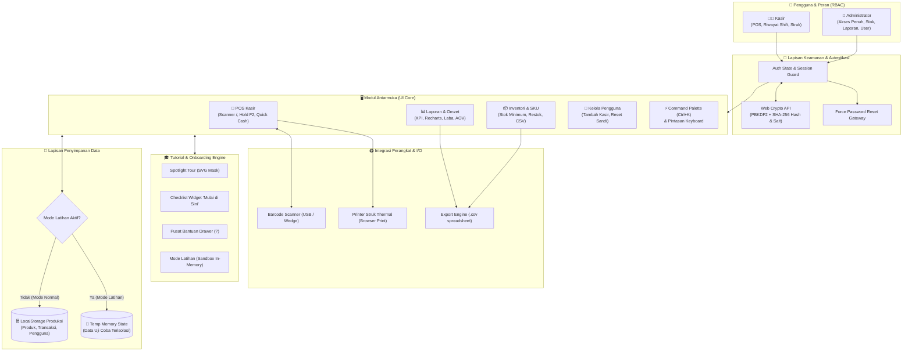

# 🛒 SobatDagang POS & Inventory

<div align="center">


### Sistem Kasir Digital (POS) & Manajemen Inventori UMKM Modern

[](https://react.dev/)
[](https://www.typescriptlang.org/)
[](https://vitejs.dev/)
[](https://tailwindcss.com/)
[](https://motion.dev/)
[](LICENSE)

*Aplikasi web Point of Sale (POS) dan manajemen inventori toko ritel/sembako yang cepat, elegan, dan siap pakai. Dirancang khusus untuk efisiensi meja kasir tinggi, dilengkapi kontrol hak akses (RBAC), analitik keuangan, onboarding interaktif, serta mode latihan sandbox untuk kasir baru.*

</div>

---

## 📐 Gambaran Sistem & Arsitektur

SobatDagang dibangun dengan arsitektur **client-first reactive SPA** yang tangguh, modular, dan bebas lag. Seluruh alur data dikelola secara deterministik dengan mekanisme isolasi sesi latihan (*Practice Mode*) untuk menjamin integritas data toko riil.

### 1. Diagram Arsitektur Komponen & Alur Data (Mermaid)



---

### 2. Lapisan Arsitektur (Layer Breakdown)

| Lapisan | Komponen Utama | Peran & Tanggung Jawab |
| :--- | :--- | :--- |
| **Presentation Layer** | React 19, Motion v12, Tailwind v4 | Antarmuka interaktif responsif, transisi micro-interactions, popover dinamis, dan rendering struk siap cetak. |
| **Business Logic Layer** | React Hooks, State Orchestrator (`App.tsx`) | Pengelolaan keranjang belanja, kalkulasi pajak & kembalian, validasi transaksi, filter laporan harian/rentang tanggal. |
| **Onboarding & Tutorial** | `src/features/onboarding/` | Spotlight tour berlubang dinamis (SVG cut-out), checklist tugas otomatis tersinkronisasi event riil, dan drawer bantuan pencarian live. |
| **Security & RBAC** | `src/lib/crypto.ts`, `src/lib/permissions.ts` | Hashing PBKDF2 Web Crypto API standar industri, validasi sesi login, penguncian rute berdasarkan peran akun. |
| **Data & Storage Layer** | Browser `localStorage` + Memory Sandbox | Penyimpanan lokal instan tanpa latency server, dilengkapi *switch toggle* yang mengisolasi transaksi saat mode latihan berjalan. |
| **Device Integration** | Standard Browser APIs & Keyboard Wedge | Kompatibel langsung dengan barcode scanner USB plug-and-play dan printer kasir thermal 58mm/80mm tanpa driver tambahan. |

---

## ✨ Fitur-Fitur Utama

SobatDagang dirancang secara menyeluruh untuk menjawab tantangan operasional harian toko ritel, minimarket, dan UMKM:

### 1. ⚡ POS Kasir Super Cepat (High-Throughput Checkout)
- **Fokus & Scan Seketika (<kbd>/</kbd>)**: Input pencarian langsung otomatis menangkap scan barcode scanner. Tekan <kbd>Enter</kbd> untuk memasukkan barang dengan SKU yang cocok ke keranjang.
- **Tahan Transaksi / Hold Cart (<kbd>F2</kbd>)**: Simpan antrean keranjang pembeli yang ingin mengambil barang tambahan, layani pembeli berikutnya, lalu pulihkan keranjang sebelumnya kapan saja.
- **Pilihan Uang Cepat (Quick Cash)**: Tombol cerdas otomatis menghitung nominal *Uang Pas* dan pecahan lembaran rupiah terdekat (Rp 10.000, Rp 20.000, Rp 50.000, Rp 100.000) di atas total belanja.
- **Perhitungan Kembalian Real-Time**: Animasi *Count-Up* yang jelas dengan indikator warna hijau terang untuk meminimalkan salah hitung kasir.
- **Dukungan Pembayaran Fleksibel**: Pilihan pembayaran **Tunai** dan **QRIS Dinamis** lengkap dengan panduan cek mutasi manual.
- **Cetak Struk Transaksi**: Tata letak struk kasir yang rapi, teroptimasi untuk kertas thermal 58mm dan 80mm via dialog cetak browser (`Ctrl+P`).
- **Undo Penghapusan Item**: Perlindungan salah klik dengan notifikasi toast undo 5 detik saat menghapus barang dari keranjang.

### 2. 📦 Manajemen Inventori & Peringatan Stok
- **Master Data Lengkap**: Kelola SKU unik, nama barang, kategori, satuan (pcs, botol, kg, pack), harga beli (modal), harga jual, dan margin keuntungan.
- **Peringatan Stok Rendah Otomatis**: Klasifikasi status stok (*Aman*, *Hampir Habis*, dan *Habis*) berdasarkan ambang batas minimum masing-masing barang.
- **Quick Stock Adjuster**: Tombol penyesuaian stok langsung (+/-) di tabel inventori tanpa perlu membuka modal formulir yang rumit.
- **Ekspor Data (.CSV)**: Unduh seluruh basis data barang ke format spreadsheet Excel/CSV untuk keperluan audit stok fisik (*stock opname*).
- **Auto-Draft & Storage Monitor**: Menyimpan draf input barang baru secara berkala agar data tidak hilang saat tab browser tidak sengaja tertutup.

### 3. 📊 Laporan Penjualan & Analitik Bisnis (Khusus Admin)
- **4 Kartu Metrik KPI Utama**:
  - **Total Omzet**: Akumulasi nilai penjualan kotor dalam periode terpilih.
  - **Total Transaksi**: Jumlah nota/struk yang berhasil diproses.
  - **Estimasi Laba Bersih**: Keuntungan riil hasil selisih harga jual dan harga modal barang.
  - **Rata-Rata Keranjang (AOV)**: Nilai rata-rata pengeluaran pelanggan per transaksi.
- **Grafik Interaktif Recharts**: Grafik tren omzet harian dan diagram lingkaran persentase metode pembayaran (Tunai vs QRIS).
- **Filter Fleksibel**: Pilihan preset cepat (Hari Ini, 7 Hari Terakhir, 30 Hari Terakhir) dan pemilih rentang tanggal kustom (*Date Range Picker*).
- **Riwayat Penjualan Lengkap**: Filter berdasarkan nomor invoice, kasir yang bertugas, atau jenis barang, disertai tombol ekspor laporan CSV.

### 4. 👨‍💼 Menu Khusus "Riwayat Saya" (Fokus Kasir)
- Tampilan khusus kasir yang menjaga kerahasiaan total omzet toko.
- Kasir dapat melihat daftar transaksi shift miliknya sendiri untuk hari berjalan.
- Cetak ulang struk pelanggan jika diperlukan.
- Tombol **Ringkasan Tutup Kasir**: Menampilkan rincian total uang tunai yang terkumpul di laci kasir dan total transaksi QRIS untuk memudahkan serah terima shift.

### 5. 🔐 Kontrol Akses Berbasis Peran & Keamanan Akun (RBAC)
- **Dua Peran Terpisah (Admin & Kasir)**: Hak akses menu dan data dibatasi secara ketat di tingkat rute dan komponen antarmuka.
- **Enkripsi Sandi PBKDF2**: Kata sandi diamankan menggunakan standar kriptografi Web Crypto API (`crypto.subtle`) dengan salt unik per pengguna.
- **Paksa Ganti Kata Sandi (Force Password Reset)**: Ketika admin mereset password staf ke sandi default/sementara, staf diwajibkan mengganti sandi baru saat pertama kali login.
- **Perlindungan Akun Admin Terakhir**: Mencegah sistem terkunci dengan melarang penghapusan atau penurunan hak akses akun admin tunggal yang tersisa.

### 6. 🎓 Sistem Onboarding & Mode Latihan (Practice Sandbox)
- **Modal Sambutan Ramah (`WelcomeModal`)**: Sapaan personal nama staf beserta ringkasan 3 langkah penting sesuai perannya.
- **Tur Interaktif Mandiri (`GuidedTour`)**: Efek spotlight sorotan elemen dinamis yang memandu langkah demi langkah tanpa mengganggu tata letak halaman.
- **Checklist Mengambang ("Mulai di Sini")**: Widget checklist di sudut layar yang otomatis mencentang tugas saat aksi nyata berhasil dilakukan.
- **Pusat Bantuan (`HelpCenterDrawer`)**: Akses cepat via tombol <kbd>?</kbd> berisi dokumentasi langkah demi langkah, FAQ, dan tabel pintasan keyboard.
- **Mode Latihan Kasir (Sandbox)**: Kasir baru dapat berlatih input belanja, simulasi pembayaran, dan manipulasi stok tanpa takut merusak pembukuan toko asli.

---

## 🔄 Alur Operasional Sistem (System Workflows)

### Alur 1: Transaksi Penjualan di Meja Kasir
```text
[Scan Barcode / Tekan '/'] 
       │
       ▼
[Produk Masuk ke Keranjang] ──(Opsional: Tahan Antrean F2)──> [Lanjut Layani Pelanggan Lain]
       │
       ▼
[Tekan Ctrl+Enter / Tombol Bayar]
       │
       ▼
[Pilih Uang Cepat / Scan QRIS]
       │
       ▼
[Hitung Kembalian Otomatis] ──> [Klik Proses Pembayaran]
       │
       ▼
[Stok Otomatis Terpotong] ──> [Cetak Struk Thermal Ctrl+P] ──> [Selesai / Transaksi Baru]
```

### Alur 2: Serah Terima Shift & Tutup Kasir
```text
[Kasir Masuk Menu 'Riwayat Saya']
       │
       ▼
[Klik 'Ringkasan Tutup Kasir']
       │
       ▼
[Sistem Menampilkan: Total Kas Tunai & Total QRIS Shift Hari Ini]
       │
       ▼
[Hitung Fisik Uang di Laci Kasir] ──> [Kesesuaian Saldo] ──> [Serah Terima ke Supervisor]
```

---

## ⌨️ Daftar Pintasan Keyboard (Hotkeys)

Efisiensi transaksi adalah kunci kepuasan antrean pelanggan. SobatDagang mendukung navigasi papan ketik penuh:

| Pintasan | Lingkup | Fungsi & Deskripsi |
| :--- | :--- | :--- |
| <kbd>/</kbd> | POS Kasir / Inventori | Fokus langsung ke kolom pencarian / scan barcode |
| <kbd>Ctrl</kbd> + <kbd>K</kbd> / <kbd>⌘</kbd> + <kbd>K</kbd> | Global | Buka **Command Palette** untuk lompat ke menu apa pun |
| <kbd>Shift</kbd> + <kbd>/</kbd> (<kbd>?</kbd>) | Global | Buka **Pusat Bantuan & Tutorial** |
| <kbd>Ctrl</kbd> + <kbd>Enter</kbd> | POS Kasir | Buka modal konfirmasi pembayaran seketika |
| <kbd>F2</kbd> | POS Kasir | Simpan sementara transaksi (*Hold Cart*) / Pulihkan antrean |
| <kbd>N</kbd> | Inventori | Buka formulir input produk baru |
| <kbd>Esc</kbd> | Modal / Drawer | Tutup dialog, modal pembayaran, atau drawer bantuan |

---

## 🛠️ Tech Stack & Spesifikasi Teknis

- **Frontend Core**: [React 19](https://react.dev/) + [TypeScript 5.8](https://www.typescriptlang.org/)
- **Build Engine**: [Vite 6](https://vitejs.dev/) (Fast HMR & Optimized Rollup Production Bundling)
- **Utility Styling**: [Tailwind CSS v4](https://tailwindcss.com/)
- **Micro-Animations**: [Motion](https://motion.dev/) (Framer Motion v12) dengan kepatuhan `prefers-reduced-motion`
- **Charts & Data Viz**: [Recharts](https://recharts.org/) (Grafik Omzet & Diagram Metode Pembayaran)
- **Icons**: [Lucide React](https://lucide.dev/)
- **Security**: Web Crypto API native browser (`PBKDF2`, `SHA-256`, 100.000 iterasi)
- **Storage**: Browser LocalStorage dengan skema terstruktur & *in-memory practice overlay*

---

## 🚀 Panduan Memulai (Quick Start)

### Prasyarat
- [Node.js](https://nodejs.org/) versi 18.0 atau yang lebih baru
- Package manager: `npm`, `pnpm`, atau `yarn`

### Langkah Pemasangan

1. **Clone repositori**:
   ```bash
   git clone https://github.com/username/sobatdagang-pos.git
   cd sobatdagang-pos
   ```

2. **Pasang dependensi**:
   ```bash
   npm install
   ```

3. **Jalankan development server**:
   ```bash
   npm run dev
   ```
   Aplikasi langsung dapat diakses di browser pada `http://localhost:3000`.

4. **Kompilasi & Build Produksi**:
   ```bash
   npm run build
   ```
   File hasil build yang siap di-deploy ke Vercel, Netlify, Cloudflare Pages, atau GitHub Pages akan tersedia di folder `dist/`.

---

## 🔑 Akun Demo Bawaan

Sistem telah dilengkapi akun bawaan untuk mempermudah evaluasi fitur:

| Username | Password | Role | Lingkup Akses |
| :--- | :--- | :--- | :--- |
| `admin` | `admin123` | **Admin** | Akses penuh (Dashboard, POS, Inventori, Laporan, Pengguna) |
| `kasir` | `kasir123` | **Kasir** | POS Penjualan, Hold Cart, dan Riwayat Saya |

> 💡 *Tips Pengujian: Masuk sebagai `admin` untuk menambahkan produk baru, memantau grafik analitik, atau membuat akun kasir tambahan.*

---

## 📁 Struktur Direktori Proyek

```text
├── src/
│   ├── components/
│   │   ├── auth/          # Login, Sesi, & Ganti Password Wajib
│   │   ├── dashboard/     # Kartu KPI, Grafik Recharts, Peringatan Stok
│   │   ├── global/        # Sidebar, Topbar, Command Palette, Pengaturan
│   │   ├── inventory/     # Manajemen SKU, Edit Stok Cepat, Ekspor CSV
│   │   ├── motion/        # Reusable animations (PageTransition, CountUp, Stagger)
│   │   ├── pos/           # Terminal Kasir, Keranjang, Modal Bayar, Riwayat Shift
│   │   ├── reports/       # Laporan Omzet, Filter Tanggal, Ekspor CSV Keuangan
│   │   ├── ui/            # UI Primitives (Button, Modal, Drawer, Toast, Table)
│   │   └── users/         # Kelola Kredensial, Role Admin/Kasir, Reset Password
│   ├── features/
│   │   └── onboarding/    # GuidedTour (SVG Mask), WelcomeModal, Checklist, HelpDrawer
│   ├── hooks/             # Custom hooks (useHotkeys, useLocalStorage, useUndoToast)
│   ├── lib/               # Utility helper, Enkripsi PBKDF2 Web Crypto, Matriks RBAC
│   ├── types.ts           # Definisi TypeScript interface data model
│   ├── constants.ts       # Mock database awal sembako & kategori
│   ├── App.tsx            # Main application layout, state orchestrator, & practice toggle
│   └── main.tsx           # Entry point React
├── public/                # Favicon dan aset statis
├── package.json
└── vite.config.ts
```

---

## 🤝 Kontribusi

Kontribusi dari komunitas sangat dinantikan! Untuk berkontribusi:
1. Fork repositori ini
2. Buat branch fitur Anda: `git checkout -b feature/fitur-baru`
3. Commit perubahan: `git commit -m 'feat: menambahkan fitur baru'`
4. Push ke branch: `git push origin feature/fitur-baru`
5. Buat **Pull Request**

---

## 📄 Lisensi

Didistribusikan di bawah lisensi [MIT](LICENSE). Terbuka untuk digunakan, dimodifikasi, dan diterapkan pada usaha UMKM Anda.

<div align="center">
  Dibuat dengan ❤️ untuk kemajuan UMKM, Toko Kelontong, dan Ritel Modern Indonesia
</div>
