# 🛒 SobatDagang POS & Inventory

<div align="center">


### Sistem Kasir Digital (POS) & Manajemen Inventori UMKM Modern

[](https://react.dev/)
[](https://www.typescriptlang.org/)
[](https://vitejs.dev/)
[](https://tailwindcss.com/)
[](https://motion.dev/)
[](LICENSE)

*Aplikasi web Point of Sale (POS) dan manajemen inventori toko ritel/sembako yang cepat, elegan, dan siap pakai. Dirancang khusus untuk efisiensi meja kasir tinggi, dilengkapi kontrol hak akses (RBAC), analitik keuangan, onboarding interaktif, serta mode latihan sandbox untuk kasir baru.*

<br />

### 🖥️ Preview Antarmuka Sistem POS Kasir SobatDagang


</div>

---

## 📐 Gambaran Sistem & Arsitektur (System Architecture)

SobatDagang mengadopsi arsitektur **Client-First Reactive SPA** dengan *micro-module topology*. Sistem beroperasi tanpa latency server untuk pemrosesan nota transaksi di meja kasir, serta dilengkapi isolasi *ephemeral in-memory sandbox* untuk latihan pegawai kasir baru.

### 1. Diagram Topologi Arsitektur Sistem (High-Level Architecture Schematic)

```mermaid
flowchart TB
    subgraph Pengguna["👤 Pengguna & Peran (RBAC)"]
        Kasir["👨‍💼 Kasir\n(POS, Riwayat Shift, Struk)"]
        Admin["👑 Administrator\n(Akses Penuh, Stok, Laporan, User)"]
    end

    subgraph Security["🔐 Lapisan Keamanan & Autentikasi"]
        AuthContext["Auth State & Session Guard"]
        CryptoEngine["Web Crypto API\n(PBKDF2 + SHA-256 Hash & Salt)"]
        ForceReset["Force Password Reset Gateway"]
        AuthContext <--> CryptoEngine
        AuthContext --> ForceReset
    end

    subgraph UI_Modules["🖥️ Modul Antarmuka (UI Core)"]
        POSModule["🛒 POS Kasir\n(Scanner /, Hold F2, Quick Cash)"]
        InvModule["📦 Inventori & SKU\n(Stok Minimum, Restok, CSV)"]
        RepModule["📊 Laporan & Omzet\n(KPI, Recharts, Laba, AOV)"]
        UserModule["👥 Kelola Pengguna\n(Tambah Kasir, Reset Sandi)"]
        GlobalTools["⚡ Command Palette (Ctrl+K)\n& Pintasan Keyboard"]
    end

    subgraph Onboarding["🎓 Tutorial & Onboarding Engine"]
        GuidedTour["Spotlight Tour (SVG Mask)"]
        Checklist["Checklist Widget 'Mulai di Sini'"]
        HelpDrawer["Pusat Bantuan Drawer (?)"]
        PracticeSandbox["Mode Latihan (Sandbox In-Memory)"]
    end

    subgraph Hardware_IO["🖨️ Integrasi Perangkat & I/O"]
        BarcodeScan["Barcode Scanner (USB / Wedge)"]
        ThermalPrint["Printer Struk Thermal (Browser Print)"]
        CSVExport["Export Engine (.csv spreadsheet)"]
    end

    subgraph Storage_Layer["💾 Lapisan Penyimpanan Data"]
        StorageSwitcher{"Mode Latihan Aktif?"}
        ProdDB[("🗄️ LocalStorage Produksi\n(Produk, Transaksi, Pengguna)")]
        MemoryDB[("🧪 Temp Memory State\n(Data Uji Coba Terisolasi)")]
    end

    %% Hubungan
    Kasir --> AuthContext
    Admin --> AuthContext
    AuthContext --> UI_Modules

    POSModule <--> BarcodeScan
    POSModule --> ThermalPrint
    RepModule --> CSVExport
    InvModule --> CSVExport

    UI_Modules <--> Onboarding
    UI_Modules <--> StorageSwitcher

    StorageSwitcher -- "Tidak (Mode Normal)" --> ProdDB
    StorageSwitcher -- "Ya (Mode Latihan)" --> MemoryDB
```

<div align="center">
  
</div>

<br />



---

### 2. Lapisan Arsitektur (Layer Breakdown)

| Lapisan | Komponen Utama | Peran & Tanggung Jawab Teknis |
| :--- | :--- | :--- |
| **Presentation Layer** | React 19, Motion v12, Tailwind v4 | Antarmuka interaktif responsif, micro-interactions, popover dinamis, dan rendering layout thermal printing. |
| **Business Logic Layer** | Custom Hooks, State Orchestrator (`App.tsx`) | Pengelolaan keranjang belanja, kalkulasi pajak, diskon & kembalian, validasi transaksi, filter laporan harian. |
| **Onboarding & Tutorial** | `src/features/onboarding/` | Spotlight tour berlubang dinamis (SVG cut-out), checklist otomatis tersinkronisasi event riil, dan help center drawer live search. |
| **Security & Cryptography** | `src/lib/crypto.ts`, `src/lib/permissions.ts` | Hashing PBKDF2 Web Crypto API (100.000 iterasi), proteksi sesi login, dan penguncian rute berdasarkan role (RBAC). |
| **Data & Storage Layer** | Browser `localStorage` + Memory Sandbox | Penyimpanan lokal instan tanpa latency server, dilengkapi *router switcher* yang mengisolasi transaksi saat mode latihan aktif. |
| **Device Integration** | Browser Native APIs & Keyboard Wedge | Kompatibel langsung dengan barcode scanner USB plug-and-play dan printer kasir thermal 58mm/80mm tanpa driver tambahan. |

---

## ⚡ Pipeline Transaksi POS & State Machine

Sistem kasir mengadopsi mesin status (*finite state machine*) 5-tahap yang menjamin kecepatan kasir melayani antrean ramai tanpa freeze atau double-submission:

<div align="center">
  
</div>

<br />

1. **Step 1: Capture & Focus (`/`)**: Input pencarian global langsung menangkap kode barcode scanner USB via keyboard wedge. Pencocokan SKU presisi otomatis menambahkan kuantitas barang ke keranjang belanja saat tombol Enter terpicu.
2. **Step 2: Buffer & Hold Cart (`F2`)**: Antrean belanja pelanggan dapat ditahan ke dalam memori antrean (*Hold Cart Stack*) saat pelanggan mengambil barang tambahan, membebaskan kasir melayani pembeli lain. Dilengkapi tombol *hold-to-repeat stepper* dan *Undo 5 detik* bila salah menghapus item.
3. **Step 3: Tender & Quick Cash Calculator (`Ctrl+Enter`)**: Sistem cerdas otomatis menganalisis total belanja dan menyajikan opsi uang pas serta pecahan Rupiah terdekat (Rp 10.000, 20.000, 50.000, 100.000) di atas nilai nota. Nilai kembalian dihitung secara *real-time* dengan visual Count-Up.
4. **Step 4: Atomic Commit & Stock Deduction**: Pengurangan kuantitas stok barang di inventori diproses secara sinkron bersamaan dengan penerbitan nomor invoice unik (`INV-TIMESTAMP`). Bila dalam *Practice Mode*, transaksi dialihkan ke RAM sementara sehingga stok toko riil terlindungi.
5. **Step 5: Output & Thermal Spooling**: Nota belanja siap dikirim ke printer kasir thermal (kertas 58mm / 80mm) via dialog cetak browser, dan transaksi otomatis dibukukan ke log shift kasir untuk keperluan tutup buku (*closing*).

---

## 🔐 Keamanan Kriptografi & Matriks Hak Akses (RBAC)

Keamanan data toko ritel dijaga dengan standar kriptografi industri tanpa bergantung pada penyimpanan password berbasis teks biasa (*plaintext*):

<div align="center">
  
</div>

<br />

### Detail Implementasi Keamanan:
- **Enkripsi Kunci PBKDF2 Native**: Menggunakan implementasi Web Crypto API (`crypto.subtle.deriveBits`) dengan digest **SHA-256**, garam acak kriptografi 16-byte (`crypto.getRandomValues`), serta **100.000 iterasi**. Password asli segera dihancurkan dari memori setelah derivasi hash.
- **Partisi Matriks Hak Akses (RBAC)**:
  - **Admin (Owner)**: Akses tanpa batas ke Dashboard, Katalog & Edit Stok Inventori, Laporan Finansial (Omzet, Laba, AOV), Manajemen Staf, dan Ekspor Database.
  - **Kasir (Staff)**: Hanya dapat mengakses Terminal POS Penjualan dan menu **Riwayat Saya** (daftar nota shift hari ini dan rekap kas tutup kasir). Akses ke data laba, modal beli, dan omzet toko diblokir secara ketat di tingkat kode antarmuka.
- **Gerbang Paksa Ganti Sandi (*Force Password Reset*)**: Saat admin mengatur ulang sandi kasir ke nilai awal/default, akun tersebut diwajibkan membuat password baru berkekuatan tinggi sebelum dapat mengakses menu toko.
- **Pengaman Anti-Lockout Admin Terakhir**: Sistem secara otomatis menolak aksi penghapusan akun atau penurunan role bila admin yang bersangkutan adalah satu-satunya admin aktif yang tersisa.

---

## ✨ Fitur-Fitur Utama Lengkap

### 1. 🛒 POS Kasir Cerdas & Cepat
- **Scan Barcode Seketika (<kbd>/</kbd>)**: Fokus otomatis dengan shortcut keyboard; tekan Enter untuk memasukkan produk.
- **Tahan Transaksi / Hold Cart (<kbd>F2</kbd>)**: Simpan keranjang sementara dan lanjutkan kapan saja.
- **Pilihan Uang Cepat (Quick Cash)**: Tombol instan uang pas dan pembulatan pecahan lembar Rupiah.
- **Penghitungan Kembalian Count-Up**: Animasi angka kembalian yang meminimalisir kekeliruan kasir.
- **Metode Pembayaran Tunai & QRIS**: Dukungan pembayaran tunai konvensional dan QRIS dinamis.
- **Cetak Struk Thermal**: Desain nota presisi untuk printer thermal kasir 58mm dan 80mm (`Ctrl+P`).
- **Undo 5 Detik**: Tombol batalkan penghapusan jika item tidak sengaja terhapus dari keranjang.

### 2. 📦 Manajemen Inventori & Peringatan Stok
- **Master SKU & Produk**: Foto produk/inisial avatar, kategori, satuan barang, harga beli (modal), harga jual, dan estimasi margin keuntungan.
- **Peringatan Stok Otomatis**: Indikator status stok cerdas (*Aman*, *Hampir Habis*, dan *Habis*) sesuai ambang batas minimal tiap barang.
- **Quick Stock Adjustment**: Tombol (+/-) langsung pada tabel daftar stok untuk audit cepat tanpa modal panjang.
- **Ekspor CSV**: Unduh seluruh inventori ke format `.csv` untuk pencocokan fisik (*stock opname*).
- **Auto-Draft & Storage Monitor**: Penyimpanan formulir draf otomatis dan pemantau kuota penyimpanan browser.

### 3. 📊 Laporan Penjualan & Analitik Bisnis (Admin)
- **4 Kartu Metrik KPI Utama**: Omzet Penjualan Kotor, Total Transaksi Sukses, Estimasi Laba Bersih Riil, dan Rata-rata Nilai Keranjang (*Average Order Value*).
- **Grafik Tren Interaktif Recharts**: Grafik garis omzet harian dan diagram persentase metode pembayaran (Tunai vs QRIS).
- **Filter Tanggal Kustom**: Preset instan (Hari Ini, 7 Hari, 30 Hari) dan Date Range Picker fleksibel.
- **Rekap Riwayat Lengkap**: Audit riwayat per kasir, per invoice, atau per barang dengan opsi unduh CSV pembukuan.

### 4. 👨‍💼 Menu Khusus "Riwayat Saya" (Kasir)
- Menjaga kerahasiaan total omzet bisnis dari kasir shift biasa.
- Menampilkan daftar transaksi yang dilakukan kasir yang sedang login pada hari berjalan.
- Cetak ulang struk pelanggan yang meminta salinan nota.
- **Ringkasan Tutup Kasir**: Kalkulasi otomatis total penerimaan tunai di laci kasir dan total non-tunai QRIS untuk serah terima shift.

### 5. 🎓 Tutorial, Onboarding & Mode Latihan (Sandbox)
- **Modal Sambutan Interaktif (`WelcomeModal`)**: Sapaan personal staf dengan ringkasan panduan 3 poin sesuai peran.
- **Tur Interaktif Mandiri (`GuidedTour`)**: Efek spotlight SVG cutout yang memandu pengguna langkah demi langkah.
- **Checklist Mengambang ("Mulai di Sini")**: Widget interaktif yang otomatis mencentang tugas awal saat aksi nyata terlaksana.
- **Pusat Bantuan (`HelpCenterDrawer`)**: Akses cepat <kbd>?</kbd> berisi panduan langkah, FAQ toko, dan pintasan keyboard.
- **Mode Latihan Kasir (Practice Sandbox)**: Lingkungan uji coba terisolasi bagi kasir baru untuk berlatih tanpa memengaruhi database toko asli.

---

## ⌨️ Daftar Pintasan Keyboard (Hotkeys)

| Pintasan | Lingkup | Fungsi & Aksi |
| :--- | :--- | :--- |
| <kbd>/</kbd> | POS Kasir / Inventori | Fokus cepat ke kolom pencarian / scan barcode |
| <kbd>Ctrl</kbd> + <kbd>K</kbd> / <kbd>⌘</kbd> + <kbd>K</kbd> | Global | Buka **Command Palette** global untuk navigasi cepat |
| <kbd>Shift</kbd> + <kbd>/</kbd> (<kbd>?</kbd>) | Global | Buka **Pusat Bantuan & Tutorial** |
| <kbd>Ctrl</kbd> + <kbd>Enter</kbd> | POS Kasir | Buka modal konfirmasi pembayaran seketika |
| <kbd>F2</kbd> | POS Kasir | Simpan sementara transaksi (*Hold Cart*) / Pulihkan antrean |
| <kbd>N</kbd> | Inventori | Buka modal Tambah Produk Baru |
| <kbd>Esc</kbd> | Modal / Drawer | Tutup dialog, modal bayar, atau panel bantuan aktif |

---

## 🛠️ Tech Stack & Spesifikasi Teknis

- **Frontend Core**: [React 19](https://react.dev/) + [TypeScript 5.8](https://www.typescriptlang.org/)
- **Build Engine**: [Vite 6](https://vitejs.dev/) (Rollup Optimized Bundling)
- **Utility Styling**: [Tailwind CSS v4](https://tailwindcss.com/)
- **Micro-Animations**: [Motion](https://motion.dev/) (Framer Motion v12)
- **Visualisasi Data**: [Recharts](https://recharts.org/)
- **Ikon**: [Lucide React](https://lucide.dev/)
- **Keamanan**: Web Crypto API native (`PBKDF2`, `SHA-256`, 100.000 iterasi)
- **Penyimpanan**: Browser LocalStorage dengan skema terstruktur & in-memory practice overlay

---

## 🚀 Panduan Memulai (Quick Start)

### Prasyarat
- [Node.js](https://nodejs.org/) versi 18.0+
- Package manager: `npm`, `pnpm`, atau `yarn`

### Instalasi & Menjalankan Aplikasi

1. **Clone repositori**:
   ```bash
   git clone https://github.com/username/sobatdagang-pos.git
   cd sobatdagang-pos
   ```

2. **Pasang dependensi**:
   ```bash
   npm install
   ```

3. **Jalankan development server**:
   ```bash
   npm run dev
   ```
   Aplikasi langsung aktif di `http://localhost:3000`.

4. **Build untuk produksi**:
   ```bash
   npm run build
   ```
   Hasil build siap disajikan di direktori `dist/`.

---

## 🔑 Akun Demo Pengujian

| Username | Password | Role | Hak Akses |
| :--- | :--- | :--- | :--- |
| `admin` | `admin123` | **Admin** | Akses penuh (Dashboard, POS, Inventori, Laporan, Pengguna) |
| `kasir` | `kasir123` | **Kasir** | POS Penjualan, Hold Cart, dan Riwayat Saya |

---

## 📁 Struktur Direktori Proyek

```text
├── docs/                  # Diagram teknis arsitektur & preview UI (SVG)
│   ├── architecture-diagram.svg
│   ├── pos-pipeline-diagram.svg
│   ├── pos-ui-preview.svg
│   └── security-rbac-diagram.svg
├── src/
│   ├── components/
│   │   ├── auth/          # Login, Sesi, & Ganti Password Wajib
│   │   ├── dashboard/     # Kartu KPI, Grafik Recharts, Peringatan Stok
│   │   ├── global/        # Sidebar, Topbar, Command Palette, Pengaturan
│   │   ├── inventory/     # Manajemen SKU, Edit Stok Cepat, Ekspor CSV
│   │   ├── motion/        # Reusable animations (PageTransition, CountUp, Stagger)
│   │   ├── pos/           # Terminal Kasir, Keranjang, Modal Bayar, Riwayat Shift
│   │   ├── reports/       # Laporan Omzet, Filter Tanggal, Ekspor CSV Keuangan
│   │   ├── ui/            # UI Primitives (Button, Modal, Drawer, Toast, Table)
│   │   └── users/         # Kelola Kredensial, Role Admin/Kasir, Reset Password
│   ├── features/
│   │   └── onboarding/    # GuidedTour (SVG Mask), WelcomeModal, Checklist, HelpDrawer
│   ├── hooks/             # Custom hooks (useHotkeys, useLocalStorage, useUndoToast)
│   ├── lib/               # Utility helper, Enkripsi PBKDF2 Web Crypto, Matriks RBAC
│   ├── types.ts           # Definisi TypeScript interface data model
│   ├── constants.ts       # Mock database awal sembako & kategori
│   ├── App.tsx            # Main application layout, state orchestrator, & practice toggle
│   └── main.tsx           # Entry point React
├── package.json
└── vite.config.ts
```

---

## 🤝 Kontribusi & Lisensi

Proyek ini dirilis di bawah lisensi [MIT](LICENSE). Terbuka untuk digunakan, dimodifikasi, dan diterapkan pada usaha UMKM Anda.

<div align="center">
  Dibuat dengan ❤️ untuk kemajuan UMKM, Toko Kelontong, dan Ritel Modern Indonesia
</div>
