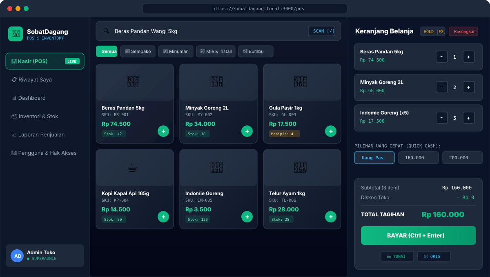
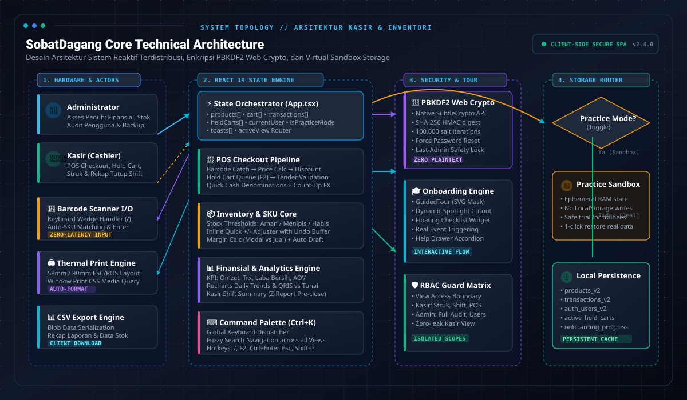
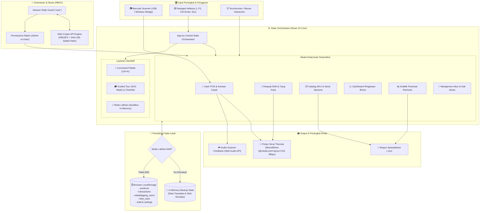
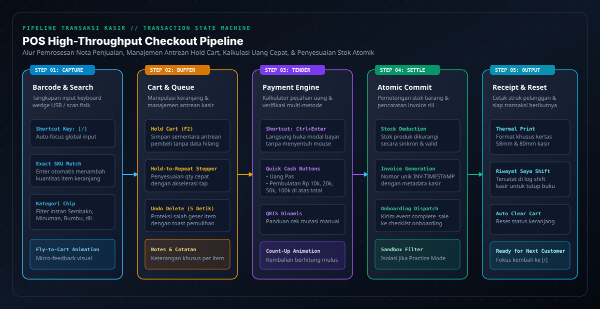
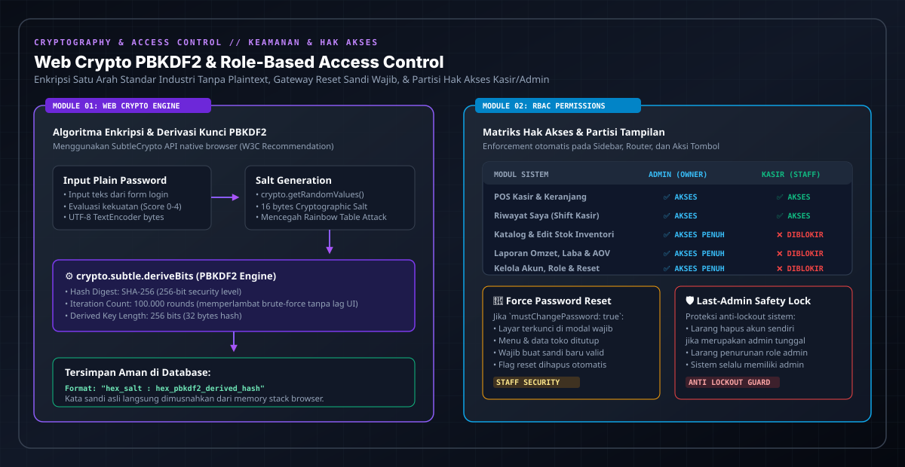

# 🛒 SobatDagang — POS & Inventory System

<div align="center">


### Sistem Kasir Digital (POS) & Manajemen Inventori UMKM Modern
*Solusi Kasir Toko Cepat, Zero-Latency, 100% Offline-Ready, & Siap Pakai Langsung di Browser*

<br />

[](https://sobat-dagang.vercel.app/)
[](https://github.com/agungrmdniiii/Sobat-Dagang)

<br />

[](https://react.dev/)
[](https://www.typescriptlang.org/)
[](https://vitejs.dev/)
[](https://tailwindcss.com/)
[](https://motion.dev/)
[](https://sobat-dagang.vercel.app/)
[](https://developer.mozilla.org/en-US/docs/Web/API/Window/localStorage)
[](LICENSE)

<br />

<a href="https://sobat-dagang.vercel.app/" target="_blank" title="Klik untuk membuka Live Demo di browser">
  
</a>

<p align="center">
  <em>👆 <strong>Live Preview</strong>: Klik gambar di atas atau tombol badge untuk membuka demo interaktif di browser Anda!</em>
</p>

</div>

---

> [!TIP]
> ### ⚡ Coba Langsung di Browser (Live Demo)
> **Aplikasi aktif & siap diuji**: **[https://sobat-dagang.vercel.app/](https://sobat-dagang.vercel.app/)**
> 
> Gunakan akun demo bawaan berikut untuk mencoba skenario pengujian:
> 
> | Peran (Role) | Username | Password | Wewenang & Akses Halaman |
> | :--- | :--- | :--- | :--- |
> | 👑 **Administrator** | `admin` | `admin123` | **Akses Penuh**: Dashboard Bisnis, Inventori & SKU, Laporan Omzet/Profit, Manajemen Pengguna, POS Kasir |
> | 👨‍💼 **Kasir (Staf)** | `kasir` | `kasir123` | **Operasional Kasir**: Meja POS Cepat, Tahan Nota (<kbd>F2</kbd>), Riwayat Shift Saya, & Tutup Kasir |
>
> *(Catatan: Seluruh data uji coba Anda tersimpan secara lokal dan terisolasi di browser masing-masing).*

---

## 🧭 Daftar Isi

- [📌 Mengapa SobatDagang? (Problem & Solution)](#-mengapa-sobatdagang-problem--solution)
- [🌐 Live Demo & Pengujian Sistem](#-live-demo--pengujian-sistem)
- [📐 Arsitektur Sistem Riil (Real System Architecture)](#-arsitektur-sistem-riil-real-system-architecture)
- [🗄️ Model Persistensi & Skema Data Lokal](#️-model-persistensi--skema-data-lokal)
- [✨ Fitur Unggulan Sistem](#-fitur-unggulan-sistem)
  - [1. 🛒 POS Kasir Super Cepat (High-Throughput Checkout)](#1--pos-kasir-super-cepat-high-throughput-checkout)
  - [2. 📦 Manajemen Inventori & Peringatan Stok](#2--manajemen-inventori--peringatan-stok)
  - [3. 📊 Laporan Penjualan & Analitik Omzet (Recharts)](#3--laporan-penjualan--analitik-omzet-recharts)
  - [4. 🧾 Rekonsiliasi Tutup Shift (Menu Khusus Kasir)](#4--rekonsiliasi-tutup-shift-menu-khusus-kasir)
  - [5. 🔐 Kontrol Akses Berbasis Peran (RBAC) & Keamanan Kriptografi](#5--kontrol-akses-berbasis-peran-rbac--keamanan-kriptografi)
  - [6. 🎓 Onboarding Interaktif & Mode Latihan (Sandbox)](#6--onboarding-interaktif--mode-latihan-sandbox)
- [🖨️ Integrasi Perangkat Keras Kasir (Hardware Setup)](#️-integrasi-perangkat-keras-kasir-hardware-setup)
- [⌨️ Daftar Pintasan Keyboard (Hotkeys)](#️-daftar-pintasan-keyboard-hotkeys)
- [📂 Struktur Direktori Proyek](#-struktur-direktori-proyek)
- [🚀 Panduan Instalasi & Pengembangan Lokal](#-panduan-instalasi--pengembangan-lokal)
- [📄 Lisensi](#-lisensi)

---

## 📌 Mengapa SobatDagang? (Problem & Solution)

Aplikasi kasir konvensional sering kali terlalu berat, membutuhkan koneksi internet stabil setiap detik untuk request API ke database server, atau mengharuskan biaya langganan bulanan yang memberatkan toko kelontong dan UMKM.

| Tantangan Meja Kasir UMKM | Solusi Nyata di SobatDagang |
| :--- | :--- |
| **Koneksi Internet Putus-Nyambung**<br>Antrean kasir terhambat saat jaringan internet toko lemot/mati. | **100% Client-First Architecture**<br>Semua proses kasir, scan barcode, dan cetak nota berjalan lokal di browser (latensi 0ms). |
| **Kebocoran Rahasia Keuntungan**<br>Kasir tidak boleh melihat laba bersih atau total omzet pemilik toko. | **Strict Role-Based Access Control (RBAC)**<br>Kasir hanya dapat mengakses POS dan rekapan uang laci shift miliknya sendiri tanpa melihat data finansial toko. |
| **Antrean Macet Saat Pelanggan Tambah Belanja**<br>Pelanggan di kasir tiba-tiba ingin mengambil barang tambahan. | **Hold Cart Engine (<kbd>F2</kbd>)**<br>Kasir dapat menahan transaksi saat ini, melayani antrean berikutnya, dan memulihkan keranjang sebelumnya seketika. |
| **Kasir Baru Takut Salah Klik**<br>Karyawan baru takut mencoba kasir karena khawatir merusak stok asli. | **Practice Mode (In-Memory Sandbox)**<br>Simulasi transaksi bebas risiko dengan pencadangan data asli toko dan pemulihan otomatis. |
| **Setup Driver Printer Thermal Rumit**<br>Butuh instalasi driver printer khusus untuk mencetak struk nota. | **Native Browser Print Optimization**<br>CSS `@media print` terisolasi 380px, kompatibel langsung dengan printer thermal 58mm/80mm tanpa driver tambahan. |

---

## 🌐 Live Demo & Pengujian Sistem

Aplikasi ini telah dideploy secara langsung di **Vercel Production**:

👉 **[https://sobat-dagang.vercel.app/](https://sobat-dagang.vercel.app/)**

### Alur Skenario Evaluasi yang Disarankan:
1. **Uji Meja Kasir (Login Kasir)**:
   - Masuk menggunakan `kasir` / `kasir123`.
   - Tekan tombol <kbd>/</kbd> untuk fokus ke pencarian, pilih beberapa produk sembako.
   - Tekan <kbd>F2</kbd> untuk menguji fitur *Hold Cart* (tahan transaksi antrean).
   - Tekan <kbd>Ctrl+Enter</kbd> untuk membuka modal pembayaran, pilih nominal **Quick Cash**, dan amati animasi kembalian.
   - Klik **Cetak Struk** untuk melihat format struk kasir thermal 58mm/80mm yang rapi.
2. **Uji Tutup Shift Kasir**:
   - Masuk ke tab **Riwayat Saya**, lalu klik **Ringkasan Tutup Kasir**.
   - Amati rincian kas tunai dan QRIS khusus untuk shift kasir saat ini tanpa membuka rahasia margin laba toko.
3. **Uji Kontrol Pemilik Toko (Login Admin)**:
   - Keluar (*logout*), lalu masuk kembali dengan `admin` / `admin123`.
   - Buka **Dashboard** dan **Laporan Penjualan** untuk memantau grafik omzet Recharts, laba bersih, dan filter tanggal.
   - Buka **Inventori** untuk menguji penyesuaian stok (+/-) dan ekspor data CSV.
   - Buka **Pengguna** untuk menguji pembuatan akun kasir baru dan fitur reset sandi.

---

## 📐 Arsitektur Sistem Riil (Real System Architecture)

SobatDagang mengusung arsitektur **Client-First Reactive SPA** dengan *in-memory ephemeral sandbox*. Sistem ini beroperasi deterministik, tangguh terhadap gangguan jaringan, dan memiliki pembagian tanggung jawab modul yang bersih.

### 1. Diagram Skematik Arsitektur Sistem

<div align="center">
  
</div>

<br />



---

### 2. Pembagian Lapisan Arsitektur (Layer Breakdown)

| Lapisan | Komponen Utama | Implementasi Nyata di Kode Sumber |
| :--- | :--- | :--- |
| **Presentation Layer** | React 19, Tailwind CSS v4, Motion v12 | Komponen modular berestetika *Warm Merchant Editorial* (`#F6F1E3` page, `#EAE4D3` surface, `#111111` typography) dengan micro-interactions, popover dinamis, dan dialog modal siap sentuh. |
| **Business Logic Layer** | React Hooks, `useLocalStorage`, `useUndoToast` | Pengelolaan keranjang belanja, kalkulasi diskon, pajak, perhitungan pecahan kembalian uang pas, dan sinkronisasi stok diorkestrasi di `src/App.tsx`. |
| **Security & RBAC Layer** | `src/lib/crypto.ts`, `src/lib/permissions.ts` | Enkripsi Web Crypto API bawaan browser (`crypto.subtle`) untuk hashing sandi dengan PBKDF2 (100.000 iterasi & salt per pengguna). Pengecekan rute dan izin komponen dikawal oleh `RoleGuard`. |
| **Storage & Persistence** | HTML5 `localStorage` API | Data operasional toko tersimpan secara instan dalam format JSON tanpa jeda waktu jaringan server. Mampu menampung ribuan produk dan riwayat transaksi dengan aman. |
| **Sandbox & Training** | `src/features/onboarding/` | Fitur isolasi data di mana sistem membuat salinan memori (*snapshot backup*) dari data asli. Saat kasir baru berlatih, data asli toko tetap aman dan dapat dipulihkan kapan saja. |
| **Device Integration** | Standard Web APIs & CSS `@media print` | Terintegrasi langsung dengan Barcode Scanner USB/Wireless (Keyboard Wedge Emulation) dan Printer Thermal 58mm/80mm via dialog cetak browser native. |

---

## 🗄️ Model Persistensi & Skema Data Lokal

SobatDagang memanfaatkan penyimpanan lokal browser secara terstruktur dengan skema kunci berikut:

```text
localStorage
├── "user"                           -> Sesi login aktif (User)
├── "sobatdagang_users"              -> Database akun & hash password (AppUser[])
├── "products"                       -> Katalog produk & status stok (Product[])
├── "transactions"                   -> Riwayat lengkap nota penjualan (Transaction[])
├── "held_carts"                     -> Antrean keranjang kasir yang ditahan (HeldCart[])
├── "sobatdagang_product_draft"      -> Draf input formulir produk baru
├── "sobatdagang_remember_username"  -> Kredensial username tersimpan pada form login
└── "sobatdagang_onboarding_{uid}"   -> State progres panduan interaktif pengguna
```

### Entitas Kunci TypeScript

```typescript
// Master Data Produk Toko
export interface Product {
  id: string;
  code: string;        // SKU atau Barcode (misal: 'BRG001')
  name: string;        // Nama barang
  category: string;    // Kategori (Beras, Minyak, Minuman, dsb.)
  buyPrice: number;    // Harga pokok / modal beli (hanya tampil di Admin)
  sellPrice: number;   // Harga jual kasir
  stock: number;       // Jumlah stok fisik di toko
  minStock: number;    // Ambang batas peringatan stok hampir habis
  unit: string;        // Satuan barang (pcs, botol, kg, pack)
  image?: string;      // URL gambar atau base64 data preview
}

// Rekaman Transaksi Penjualan
export interface Transaction {
  id: string;                  // Nomor nota faktur unik (misal: 'INV-20261015-001')
  date: string;                // ISO timestamp transaksi
  items: CartItem[];           // Daftar barang belanjaan beserta jumlah & diskon
  total: number;               // Total nominal pembayaran (Rp)
  received: number;            // Uang tunai yang diserahkan pelanggan
  change: number;              // Nominal kembalian
  paymentMethod: PaymentMethod;// 'CASH' atau 'QRIS'
  userId: string;              // ID kasir yang memproses nota
  userName: string;            // Nama kasir yang tercetak di struk
}

// Data Pengguna & Kredensial RBAC
export interface AppUser {
  id: string;
  name: string;
  username: string;
  role: 'ADMIN' | 'KASIR';
  isActive: boolean;
  passwordHash: string;        // Hash PBKDF2 SHA-256 (bukan teks polos)
  mustChangePassword?: boolean;// Paksa ganti password saat reset oleh admin
  lastLogin?: string;
  createdAt: string;
}
```

---

## ✨ Fitur Unggulan Sistem

### 1. 🛒 POS Kasir Super Cepat (High-Throughput Checkout)

<div align="center">
  
</div>

<br />

- **Fokus & Scan Seketika (<kbd>/</kbd>)**: Tekan tombol slash atau tembak barcode scanner, input pencarian langsung aktif. Tekan <kbd>Enter</kbd> untuk memasukkan barang dengan kode cocok ke keranjang dengan suara konfirmasi *beep*.
- **Tahan Transaksi / Hold Cart (<kbd>F2</kbd>)**: Simpan antrean keranjang pembeli yang ingin mengambil barang tambahan, layani pembeli berikutnya, lalu pulihkan keranjang sebelumnya kapan saja.
- **Tombol Uang Cepat (Quick Cash)**: Tombol pintar otomatis menghitung nominal *Uang Pas* dan pecahan lembaran rupiah terdekat (Rp 10.000, Rp 20.000, Rp 50.000, Rp 100.000) di atas total belanja.
- **Perhitungan Kembalian Real-Time**: Animasi *Count-Up* yang jelas dengan indikator warna hijau terang untuk meminimalkan salah hitung kasir.
- **Dukungan Pembayaran Fleksibel**: Pilihan pembayaran **Tunai** dan **QRIS Dinamis** lengkap dengan panduan konfirmasi status manual.
- **Cetak Struk Transaksi Thermal**: Desain struk yang presisi, teroptimasi untuk kertas thermal 58mm dan 80mm via dialog cetak browser (`Ctrl+P`).
- **Undo Penghapusan Item**: Perlindungan salah klik dengan notifikasi toast undo 5 detik saat menghapus barang dari keranjang belanja.

---

### 2. 📦 Manajemen Inventori & Peringatan Stok

- **Katalog SKU Lengkap**: Kelola barcode, nama barang, kategori, satuan, harga modal, harga jual, dan margin keuntungan secara transparan.
- **Peringatan Stok Rendah Otomatis**: Klasifikasi status stok (*Aman*, *Hampir Habis*, dan *Habis*) berdasarkan ambang batas minimum masing-masing barang.
- **Quick Stock Adjuster**: Tombol penyesuaian stok langsung (+/-) di tabel inventori tanpa perlu membuka modal formulir yang rumit.
- **Ekspor Data (.CSV)**: Unduh seluruh basis data barang ke format spreadsheet Excel/CSV untuk keperluan audit stok fisik (*stock opname*).
- **Auto-Draft Formulir**: Menyimpan draf input barang baru secara berkala agar data tidak hilang saat tab browser tidak sengaja tertutup.

---

### 3. 📊 Laporan Penjualan & Analitik Omzet (Recharts)

- **4 Kartu Metrik KPI Utama**:
  - **Total Omzet**: Akumulasi nilai penjualan kotor dalam periode terpilih.
  - **Total Transaksi**: Jumlah nota/struk yang berhasil diproses.
  - **Estimasi Laba Bersih**: Keuntungan riil hasil selisih harga jual dan harga modal barang.
  - **Rata-Rata Keranjang (AOV)**: Nilai rata-rata pengeluaran pelanggan per transaksi.
- **Grafik Interaktif Recharts**: Grafik tren omzet harian dan diagram lingkaran persentase metode pembayaran (Tunai vs QRIS).
- **Filter Fleksibel**: Pilihan preset cepat (Hari Ini, 7 Hari Terakhir, 30 Hari Terakhir) dan pemilih rentang tanggal kustom (*Date Range Picker*).
- **Riwayat Penjualan Lengkap**: Filter berdasarkan nomor invoice, kasir yang bertugas, atau jenis barang, disertai tombol ekspor laporan CSV.

---

### 4. 🧾 Rekonsiliasi Tutup Shift (Menu Khusus Kasir)

- **Menjaga Kerahasiaan Toko**: Tampilan khusus kasir yang membatasi akses agar kasir tidak dapat melihat total omzet toko dan keuntungan modal pemilik.
- **Daftar Nota Shift Sendiri**: Kasir hanya melihat daftar transaksi shift miliknya sendiri untuk hari berjalan.
- **Cetak Ulang Struk Pelanggan**: Kemudahan mencetak ulang struk pelanggan jika kertas thermal sebelumnya tersendat.
- **Ringkasan Tutup Kasir**: Menampilkan rincian total uang tunai yang terkumpul di laci kasir dan total transaksi QRIS untuk memudahkan serah terima shift ke supervisor/pemilik toko.

---

### 5. 🔐 Kontrol Akses Berbasis Peran (RBAC) & Keamanan Kriptografi

<div align="center">
  
</div>

<br />

| Fitur / Halaman | Admin | Kasir | Penjelasan Kebijakan Bisnis |
| :--- | :---: | :---: | :--- |
| **Dashboard Bisnis** | ✅ | ❌ | Menyajikan grafik omzet total, laba bersih, dan tren harian toko. Dilarang bagi kasir demi privasi bisnis. |
| **POS Kasir** | ✅ | ✅ | Transaksi penjualan langsung, scan barcode, penahanan nota (*Hold Cart*), dan cetak struk kasir. |
| **Riwayat Saya (Shift Kasir)** | ✅ | ✅ | Kasir hanya dapat melihat riwayat transaksi miliknya sendiri hari ini dan rekap uang fisik laci tanpa melihat keuntungan toko. |
| **Inventori & SKU** | ✅ | ❌ | Tambah barang, ubah harga beli/jual, sesuaikan stok, dan ekspor CSV katalog. |
| **Laporan Penjualan** | ✅ | ❌ | Analitik keuangan lengkap, margin kotor/bersih, performa kasir, dan ekspor CSV transaksi. |
| **Kelola Pengguna** | ✅ | ❌ | Tambah staf kasir, nonaktifkan akun, ganti peran, dan reset sandi dengan pengamanan *force reset*. |
| **Mode Latihan (Sandbox)** | ✅ | ✅ | Simulasi transaksi bebas risiko bagi kasir baru tanpa merusak data pembukuan asli toko. |

> [!IMPORTANT]
> **Kebijakan Keamanan Kredensial**:
> 1. Akun Admin tidak dapat menurunkan (*demote*) role atau menghapus akunnya sendiri saat sedang login.
> 2. Sistem mencegah penghapusan akun Admin terakhir; minimal harus selalu ada satu Administrator aktif di sistem.
> 3. Kata sandi di-hash menggunakan **Web Crypto API** (`crypto.subtle`) standar industri (PBKDF2 SHA-256, 100.000 iterasi, dengan salt acak unik per pengguna).
> 4. Kata sandi yang di-reset oleh Admin akan menandai flag `mustChangePassword = true`, mewajibkan staf mengganti password pribadi saat login pertama.

---

### 6. 🎓 Onboarding Interaktif & Mode Latihan (Sandbox)

- **Modal Sambutan Ramah (`WelcomeModal`)**: Sapaan personal nama staf beserta ringkasan 3 langkah penting sesuai perannya.
- **Tur Interaktif Mandiri (`GuidedTour`)**: Efek spotlight sorotan elemen dinamis yang memandu langkah demi langkah tanpa mengganggu tata letak halaman.
- **Checklist Mengambang ("Mulai di Sini")**: Widget checklist di sudut layar yang otomatis mencentang tugas saat aksi nyata berhasil dilakukan.
- **Pusat Bantuan (`HelpCenterDrawer`)**: Akses cepat via tombol <kbd>?</kbd> berisi dokumentasi langkah demi langkah, FAQ operasional, dan tabel pintasan keyboard.
- **Mode Latihan Kasir (Sandbox In-Memory)**: Kasir baru dapat mengaktifkan mode simulasi untuk mencoba scan barang, bayar tunai/QRIS, dan tahan nota tanpa takut merusak pembukuan toko asli.

---

## 🖨️ Integrasi Perangkat Keras Kasir (Hardware Setup)

SobatDagang siap digunakan langsung dengan perangkat kasir standar industri:

### 1. Barcode Scanner (USB / Wireless 2.4 GHz)
- **Tipe**: Standar *Keyboard Wedge / HID Emulation*.
- **Cara Kerja**: Scanner membaca kode batang (EAN-13, UPC, Code 128) dan mengirimkannya sebagai ketikan keyboard yang diakhiri karakter `Enter`.
- **Implementasi**: Tekan tombol <kbd>/</kbd> untuk memfokuskan kursor ke kolom pencarian POS. Saat barcode ditembak, produk yang SKU-nya cocok langsung otomatis masuk ke keranjang belanja dengan efek suara *beep*.

### 2. Printer Struk Kasir Thermal (58mm & 80mm)
- **Tipe**: Printer thermal USB, Bluetooth, atau LAN (misal: Epson TM-T82, Panda, POS-58, Iware, Kassen).
- **Cara Kerja**: Memanfaatkan browser native print API (`window.print()`).
- **Desain Struk Khusus**:
  - CSS `@media print` secara otomatis menyembunyikan navigasi, sidebar, dan tombol antarmuka web.
  - Elemen `#receipt` diisolasi dengan batas lebar standar **380px** (pas untuk kertas thermal 58mm dan 80mm).
  - Teks diformat dalam font monospaced berkontras tinggi dengan rincian nama toko, nomor invoice, daftar item, total, uang diterima, kembalian, dan ucapan terima kasih.

---

## ⌨️ Daftar Pintasan Keyboard (Hotkeys)

Navigasi cepat meja kasir tanpa perlu menyentuh mouse:

| Pintasan Keyboard | Halaman / Lingkup | Fungsi Operasional |
| :--- | :--- | :--- |
| <kbd>/</kbd> | POS Kasir & Inventori | Fokus langsung ke kolom pencarian produk / barcode scanner |
| <kbd>Ctrl</kbd> + <kbd>K</kbd> / <kbd>⌘</kbd> + <kbd>K</kbd> | Global (Seluruh Halaman) | Buka **Command Palette** untuk berpindah menu dengan cepat |
| <kbd>Shift</kbd> + <kbd>/</kbd> (<kbd>?</kbd>) | Global (Seluruh Halaman) | Buka **Pusat Bantuan, Panduan Tutorial, & FAQ** |
| <kbd>Ctrl</kbd> + <kbd>Enter</kbd> | POS Kasir | Buka modal konfirmasi pembayaran seketika |
| <kbd>F2</kbd> | POS Kasir | Tahan antrean transaksi (*Hold Cart*) / Pulihkan keranjang belanja |
| <kbd>N</kbd> | Inventori Produk | Buka formulir tambah produk baru (khusus Admin) |
| <kbd>Esc</kbd> | Global Modal / Drawer | Tutup dialog pop-up, modal pembayaran, atau drawer samping |

---

## 📂 Struktur Direktori Proyek

```text
Sobat-Dagang/
├── index.html                   # HTML entry point dengan link font DM Sans
├── package.json                 # Konfigurasi dependensi & npm scripts
├── vite.config.ts               # Konfigurasi bundler Vite 6 & Tailwind CSS v4
├── tsconfig.json                # Konfigurasi compiler TypeScript
├── docs/                        # Diagram arsitektur & asset grafis preview UI (SVG)
│   ├── pos-ui-preview.svg       # Mockup visual live preview antarmuka POS
│   ├── architecture-diagram.svg # Diagram topologi arsitektur sistem
│   ├── pos-pipeline-diagram.svg # Diagram pipeline alur transaksi kasir
│   └── security-rbac-diagram.svg# Diagram kriptografi & hak akses RBAC
├── src/
│   ├── main.tsx                 # Bootstrapper React 19
│   ├── App.tsx                  # State orchestrator sentral, POS view, cart, & modal transaksi
│   ├── index.css                # Tailwind base, CSS variables tema warm editorial, & @media print
│   ├── types.ts                 # Definisi TypeScript interface (Product, Transaction, AppUser, dsb.)
│   ├── constants.ts             # Data inisial katalog sembako, kategori produk, & pengguna awal
│   │
│   ├── components/
│   │   ├── auth/                # Halaman login, validasi sesi, & form force-reset password
│   │   ├── dashboard/           # Tampilan ringkasan metrik KPI, grafik omzet, & notifikasi stok
│   │   ├── global/              # Sidebar navigasi, Topbar, Command Palette (Ctrl+K), Settings Panel
│   │   ├── inventory/           # Tampilan inventori, pencarian SKU, filter stok, edit cepat, ekspor CSV
│   │   ├── motion/              # Komponen animasi reusable (CountUp, FadeIn, StaggerList, PageTransition)
│   │   ├── pos/                 # Komponen pendukung kasir & tampilan "Riwayat Saya" (MyHistoryView)
│   │   ├── reports/             # Laporan penjualan mendalam, analitik Recharts, filter tanggal, ekspor CSV
│   │   ├── ui/                  # Komponen antarmuka atomik (Button, Card, Modal, Drawer, Table, Toast, Badge)
│   │   └── users/               # Pengelolaan akun pengguna, penetapan peran RBAC, dan reset sandi
│   │
│   ├── features/
│   │   └── onboarding/          # Engine tutorial: GuidedTour (spotlight SVG), Checklist, HelpDrawer, Sandbox
│   │
│   ├── hooks/                   # Custom React hooks (useHotkeys, useLocalStorage, useUndoToast, useDebounce)
│   └── lib/                     # Helper utilitas, enkripsi Web Crypto API (crypto.ts), dan aturan RBAC
└── public/                      # Aset statis & ikon
```

---

## 🚀 Panduan Instalasi & Pengembangan Lokal

### Prasyarat
- [Node.js](https://nodejs.org/) versi 18.0 atau lebih tinggi
- Paket manajer: `npm`, `pnpm`, atau `yarn`

### Langkah Pemasangan

1. **Clone Repositori**:
   ```bash
   git clone https://github.com/agungrmdniiii/Sobat-Dagang.git
   cd Sobat-Dagang
   ```

2. **Pasang Dependensi**:
   ```bash
   npm install
   ```

3. **Jalankan Server Pengembangan**:
   ```bash
   npm run dev
   ```
   Aplikasi langsung dapat diakses di browser pada `http://localhost:3000`.

4. **Kompilasi Siap Produksi (Build)**:
   ```bash
   npm run build
   ```
   File hasil build yang siap di-deploy ke Vercel, Netlify, Cloudflare Pages, atau GitHub Pages akan tersedia di folder `dist/`.

---

## 📄 Lisensi

Proyek ini didistribusikan di bawah lisensi **MIT**. Bebas digunakan, dipelajari, dimodifikasi, dan diterapkan untuk mendukung digitalisasi UMKM dan toko kelontong di seluruh Indonesia.

<div align="center">
  Dibuat dengan ❤️ untuk kemajuan UMKM, Toko Kelontong, dan Ritel Modern Indonesia
  <br /><br />
  <strong><a href="https://sobat-dagang.vercel.app/">Coba SobatDagang Sekarang di Vercel →</a></strong>
</div>
